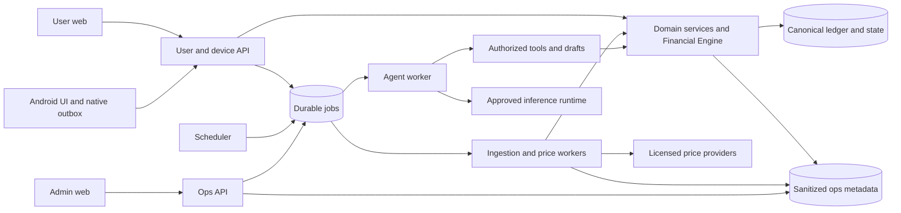

# ARCH-01 — lựa chọn kiến trúc tổng thể FinWeave

08/10/2026 · **ACCEPTED: A + T1** theo lựa chọn trực tiếp của owner. [ADR-008](adr/ADR-008-modular-backend-trusted-server.md) ghi quyết định và thay đổi trust; [HLD](high-level-design.md), [context](../requirements/context-model.md), [views](views/architecture-views.md) là thiết kế hiện hành. Không đổi API/schema, frontend hoặc immutable r1/r2. Nhận xét phù hợp/độ phức tạp/chi phí tương đối dưới đây là đánh giá kiến trúc cho FinWeave, không benchmark hay báo giá đã đo.

## 1. Quyết định đã chọn

**A — modular backend** dùng chung domain/Financial Engine, user/device API, Ops API và workers tách entrypoints/lifecycle/quyền. **T1 — trusted server** cho phép backend xử lý finance dạng rõ; host/runtime/DBA/backup/key operators thuộc bên được tin và có khả năng truy cập dữ liệu. Admin ứng dụng vẫn chỉ operational metadata/safe commands.

Owner đã chủ động thay target anti-Ops cũ; [SRS NFR-08](../requirements/srs.md) và [security design](../security/security-design.md) được đồng bộ. T1 không bảo đảm toàn bộ sản phẩm miễn phí, không tự cấp ngân sách/deploy hoặc bật real transport. Auth/isolation/encryption/backup/provider controls vẫn cần kiểm trước real data.

A/B/C và T1/T2/T3 ở các bảng dưới được giữ làm phân tích so sánh. Những nhận xét T2 phù hợp với yêu cầu anti-Ops là căn cứ nghiên cứu trước quyết định; anti-Ops không còn là target bắt buộc của T1. T1 là lựa chọn hiện hành, B/C/T2/T3 chưa được chọn.

## 2. Các thành phần và trách nhiệm phải giữ

| Thành phần | Trách nhiệm | Ranh giới |
| --- | --- | --- |
| User web | Hiển thị, nhập liệu, preview/confirm, Plan/Goals, chat/history | Không giữ provider secrets hoặc tự làm authority số dư |
| Android UI + native collector | UI dùng cùng nghiệp vụ; native nhận thông báo, lọc/chuẩn hóa tối thiểu, encrypted outbox, permission/binding/upload | Listener/uploader không phụ thuộc WebView mở; không gửi raw/OTP; thông báo không bảo đảm phản ánh đủ sổ ngân hàng |
| Admin web + Ops API | Health/sources/jobs/quotas/releases/incidents/sanitized audit; safe retry/disable | Separate identity/credentials/DTO; không user finance, impersonation hoặc actual writes |
| User/device API | Authenticate/authorize/validate/preview/idempotency và dispatch commands | Client-selected workspace/role không tự tạo quyền; device upload phải đúng live binding |
| Domain services + Ledger | Sổ cái chuẩn cho từng workspace, tài khoản/tài sản/history, atomic effects | Mọi actual write đi qua rules/quyền/transaction; không direct DB từ client/Agent |
| Financial Engine | Tính balance/flow/valuation/forecast/Goal/simulation nhất quán và có version | Tính toán deterministic; AI không là máy tính tiền hoặc authority |
| Workers + scheduler | Receipt/import, giá, Agent runs, retry/lease/catch-up/retention | Công việc lưu bền; không chờ browser mở; không giữ DB transaction xuyên provider call |
| Agent orchestrator + tool gateway | Clarify, investigation/replan, draft, simulate/compare và evidence | Tools typed/scoped; không confirm thay owner, không ghi ledger, không SQL/network tùy ý |
| Database/storage | Canonical records, versions, receipts/jobs/replay/audit, backup | T1/synthetic lưu dữ liệu theo schema thông thường; T2/T3 private records cần protected storage model |
| Price/model providers | Adapter nguồn được phép; model cung cấp inference | Nguồn giá không cần nhận danh mục sở hữu/quantity; gửi finance vào model cũng là vượt một trust boundary |

Một nguồn dữ liệu tài chính đúng nghĩa là **mỗi workspace có một ledger chuẩn**, các cache/charts/read models dẫn xuất từ nó. Có thể có nhiều bảng/schema/physical stores. Không để web và mobile giữ hai sổ độc lập. Ledger FinWeave vẫn có thể thiếu dữ liệu ngân hàng nếu thông báo thiếu; phải giữ coverage/reconciliation, không tuyên bố đó là bank statement đầy đủ.

Android cung cấp callback notification và cơ chế WorkManager cho công việc bền qua restart/reboot; đây là nền tảng phù hợp cho listener + upload queue, không chứng minh mọi app/OEM luôn hoạt động. [NotificationListenerService](https://developer.android.com/reference/android/service/notification/NotificationListenerService), [WorkManager](https://developer.android.com/develop/background-work/background-tasks/persistent).

## 3. Lựa chọn tổ chức backend

| Mã | Tổ chức | Lợi ích cho FinWeave | Đánh đổi | Khuyến nghị |
| --- | --- | --- | --- | --- |
| A | Modular backend: các module dùng chung domain/Engine; user API, Ops API và worker là entrypoints; worker chạy process riêng; PostgreSQL và durable jobs | Reuse stack/contract hiện có, transaction dễ giữ atomic; có thể triển khai toàn bộ feature, kiểm local; ít thành phần vận hành | Phải enforce module boundaries; cùng DB có contention; API/worker phải tương thích khi deploy; scaling không tự vô hạn | **Đề xuất chọn** |
| B | Managed-backend-centric: ví dụ Postgres/Auth/Storage/Functions của Supabase, domain commands qua function/RPC, worker bổ sung khi cần | Giảm phần tự vận hành identity/storage/API nền; tiện cho auth/realtime | Nghiệp vụ vẫn phải viết; transactional commands phải server-side; Engine/jobs/Agent bị ràng buộc runtime/quota; thay nhiều phần baseline và tăng phụ thuộc platform | Chọn nếu ưu tiên managed platform hơn quyền chủ động runtime |
| C | Microservices: ledger, ingestion, prices, planning, Agent và Ops deploy độc lập, mỗi service sở hữu data boundary | Scale và rollout độc lập; isolate lỗi khi thiết kế tốt | Nhiều network hops, queues/versions/observability; Plan–Goal atomicity và saga khó hơn; nhiều failure modes và overhead hạ tầng | Chưa có số đo chứng minh cần; không đề xuất lúc này |

B có nền tảng thực: Supabase kết hợp Postgres với Auth, API, Realtime, Storage và Functions. Nhưng đây là các building blocks, không có sẵn FinWeave Ledger/Engine. [Supabase architecture](https://supabase.com/docs/guides/getting-started/architecture).

Theo giới hạn hiện công bố của Supabase Edge Functions, bộ nhớ 256MB và CPU/request 2s, wall-clock Free 150s. CPU khác thời gian chờ I/O: một workflow gọi model từ xa không đồng nghĩa chạy model nặng ngay trong function. Suy luận cho FinWeave: B cần benchmark Engine và chia durable steps; inference nặng cần runtime phù hợp. Hạn mức không là entitlement đã có của dự án. [Function limits](https://supabase.com/docs/guides/functions/limits).

Microsoft mô tả microservices làm tăng vấn đề transaction/data consistency và coordination giữa services. Đánh giá của tôi: FinWeave nên giữ ledger và các cập nhật cần atomic trong ranh giới nhỏ trước; không tách service chỉ vì AI có thể sinh code nhanh. [Microservices trade-offs](https://learn.microsoft.com/en-us/azure/architecture/guide/architecture-styles/microservices), [Data boundaries](https://learn.microsoft.com/en-us/azure/architecture/microservices/design/data-considerations).

Với A có thể bắt đầu một instance cho nhiều process trong synthetic nếu tài nguyên cho phép; worker/API vẫn tách lifecycle và connection limits. Host thật/số replica/Redis hoặc queue broker/domain cụ thể thuộc ARCH-02/03/09, cần đo trước khi chọn. PostgreSQL jobs là ứng viên baseline, không cam kết mọi tải đều phù hợp.

## 4. Lựa chọn trust — ai được đọc dữ liệu

| Mã | Dữ liệu riêng được giải mã ở đâu? | Ops/root/DBA | Giá/Agent khi user offline | Chi phí/độ phức tạp và ảnh hưởng |
| --- | --- | --- | --- | --- |
| T1 Trusted server | Backend thông thường; DB/app encryption với server nắm khóa | App-admin bị cấm bằng quyền, nhưng người kiểm soát runtime/DB vẫn thuộc bên được tin | Thuận lợi cho xử lý server | Dễ tận dụng nền tảng phổ biến; không đáp ứng anti-Ops cũ; **owner đã chọn T1 và thay requirement tại ADR-008** |
| T2 Protected processing | Owner client và protected workload đã xác minh; storage/relay giữ ciphertext | Mục tiêu ngăn runtime Ops đọc finance trong threat model; key/code/client authority phải độc lập | Có thể xử lý khi client offline nếu workload được cấp quyền và có compute | Phù hợp target anti-Ops trước quyết định; phức tạp hơn và chưa có proof/free deployment; cần redesign private storage/query, recovery, inference boundary |
| T3 Client-only decryption/E2EE | Chỉ thiết bị owner; server lưu/đồng bộ ciphertext | Không có private decrypt key ở server, nhưng client distribution vẫn phải bảo vệ | Có thể cập nhật public quotes; private valuation/Agent không chạy server như thiết kế hiện tại khi mọi client offline | Chuyển Engine/Agent sang thiết bị hoặc owner-controlled always-on node; cần xử lý sync/conflicts; thay kiến trúc và trải nghiệm đáng kể |

RLS không giải quyết T2: PostgreSQL ghi rõ superuser/BYPASSRLS vượt row security. Đây là lý do phải tách “admin ứng dụng không có quyền” khỏi “người quản trị máy chủ không thể đọc”. [PostgreSQL RLS](https://www.postgresql.org/docs/17/ddl-rowsecurity.html).

T2 có primitive thực, ví dụ AWS Nitro Enclaves cách ly CPU/memory, hỗ trợ attestation và không có external network/persistent storage trực tiếp. AWS KMS có thể ràng buộc dùng key vào measurements. Tuy nhiên FinWeave vẫn phải thiết kế relay/storage protocol, độc lập key policy, client trust, chống rollback, quyền workload và model boundary; bật enclave không tự chứng minh toàn bộ sản phẩm an toàn. [Nitro Enclaves](https://docs.aws.amazon.com/enclaves/latest/user/nitro-enclave.html), [Attestation/KMS](https://docs.aws.amazon.com/enclaves/latest/user/kms.html).

AWS không tính phụ phí riêng cho Nitro Enclaves nhưng vẫn tính EC2 và các dịch vụ khác. Vì vậy không thể gọi T2 là phương án miễn phí. Chưa chọn AWS hay lập báo giá trong ARCH-01. [Nitro pricing](https://docs.aws.amazon.com/enclaves/latest/user/nitro-enclave.html).

T2/T3 đều phải giải quyết web client: mã JavaScript do bên vận hành thay được có thể đọc dữ liệu sau giải mã. W3C cảnh báo script injection có thể lấy khóa/dữ liệu; suy luận áp dụng ở đây là cần trust root cho phân phối/kiểm chứng client, không chỉ thêm encryption. HTTPS/CSP hữu ích nhưng không tự ngăn chính bên có quyền thay ứng dụng phát hành mã độc. Chưa có giải pháp verified-web-client đã chứng minh cho FinWeave. [Web Crypto security considerations](https://www.w3.org/TR/webcrypto/#security-considerations).

Model provider là bên riêng: nếu gửi private finance/prompt tới API inference thông thường, provider có thể xử lý plaintext theo thiết kế giao tiếp. Dùng T2/T3 yêu cầu inference trong boundary được chấp nhận hoặc phương án dữ liệu thực sự không nhạy cảm đã đánh giá; đổi tên user thành ID không tự ẩn số tiền/danh mục. Không cam kết chạy mọi model trong enclave; phải benchmark và xác minh hạ tầng.

T3 là lựa chọn để so sánh, **không đáp ứng nguyên trạng yêu cầu full backend + xử lý tài chính/Agent trên server độc lập thiết bị**. Không đề xuất T3 nếu owner muốn giữ những yêu cầu đó. Không tự chọn nó để tiết kiệm hoặc bỏ chức năng.

## 5. Sơ đồ logic A đã chọn

Sơ đồ mô tả trách nhiệm, không là network topology hoặc privilege grants. Store/Queue/Safe có thể là các schema/roles trong synthetic PG; T1 Store cho phép storage thông thường trong trusted server; T2 alternative cần ciphertext và protected processing. Agent/Tools chỉ được gọi subset được cấp quyền: đọc facts, lưu draft, mô phỏng; mũi tên Tools→Core không cấp ledger write/confirm. Ops→Queue chỉ safe operational commands có preview/quyền/audit, không finance commands. Database queue phải tách metadata tối thiểu khỏi payload riêng.

## 6. Ba luồng chính theo A

### Notification

Notification trên Android → kiểm consent/allowlist → normalize/filter trên device → encrypted durable outbox → device API → durable receipt ACK → worker validate/match/dedupe → domain posting hoặc Review → ledger/snapshot version mới → web/mobile fetch dữ liệu có quyền. Không gọi LLM cho mọi thông báo; parser/rules xử lý việc xác định được, Agent có vai trò điều tra khi cần và chỉ trả đề xuất. Replay transport khác semantic dedupe. ACK khác posted; thiếu capture phải báo coverage gap. Với T2, minimal normalized payload vẫn là private và được seal trước khi gửi, xử lý nhạy cảm bên trong boundary.

### Price

Scheduler hằng ngày hoặc yêu cầu update → coalesce/cooldown/quota → durable price job → adapter nguồn có quyền → validate mã/profile/unit/side/time → quote observation → Engine valuation dựa quantity hiện có → snapshot/read model. Giá không thay cash/quantity/income. Đồng bộ client bằng version polling/refresh-on-focus là baseline; SSE/WebSocket có thể phát invalidation sau, không thay nguồn dữ liệu đúng. T2 có thể fetch public feed ngoài boundary nếu license cho phép, nhưng private holdings/subscriptions/valuation phải bảo vệ.

### Plan–Goals và Agent

Owner nhập mục tiêu/kế hoạch → Agent nhận context được cấp quyền → hỏi thiếu gì → đọc facts → gọi Engine simulate/compare → lưu linked draft → user sửa/preview → owner confirm riêng → PlanGoals service kiểm quyền/version/constraints → commit atomic Plan/Goal/links/history/replay. Actual ledger không đổi. Replan theo actual tạo đề xuất/draft; manual planner vẫn hoạt động khi model lỗi. Cuộc gọi model không nằm trong một transaction DB kéo dài; Agent steps có state/cancel/budget bền vững.

## 7. Độ phủ feature và nguồn dữ liệu đúng

| Nhóm backlog | Vị trí trong A |
| --- | --- |
| BE-01/02/03/04/05 | API + identity/accounts/ledger/read projection modules + Engine |
| BE-06/07 | Holdings/market modules + price worker/provider adapters |
| BE-08/09/10 | Device/source/receipt/import/Review modules + ingestion worker |
| BE-11/12/13 | Plan/Goal/simulation modules + shared deterministic Engine |
| BE-14/15 | Assistant/history + Agent worker + authorized tools/drafts |
| BE-16 | Ops API + admin metadata views and safe commands |
| BE-17 | Durable queue/dispatcher/leases/retention; background process |
| BE-18 | Cross-cutting trust/key/auth/backup boundaries theo lựa chọn T |
| BE-19/20 | Web/admin adapters và Android native/client boundary |
| BE-21 | Platform/deployment/scheduler/monitor/release/restore/UAT |

Tất cả 21 gói thuộc đích triển khai, không ưu tiên để cắt tính năng. Chưa coi mapping HLD là runtime coverage hoặc endpoint completeness proof; operation/action/screen/AC inventories ở [backlog](../product/backend-backlog.md). B/C cũng có thể triển khai full scope nhưng phải tái ánh xạ module/transaction/worker; không mặc định có đủ chỉ vì chọn platform.

## 8. Kết quả và bước thiết kế tiếp

**ARCH-01 đã chốt A + T1**; [ADR-008](adr/ADR-008-modular-backend-trusted-server.md) là decision record. Giữ đủ BE-01…21 và một ledger chuẩn mỗi workspace; Agent chỉ drafts, owner confirmation chỉ Plan/Goals.

Tiếp ARCH-02 cấu trúc modules/entrypoints/dependencies/stack, ARCH-03 platform/infrastructure/chi phí và ARCH-04 DB execution/schema. Các ARCH-05…13 tiếp tục theo [agenda](architecture-decision-agenda.md). Chưa chốt vendor/domain/model/replicas/paid plan hoặc tuyên bố security/native/backend PASS. API v2/schema và baselines giữ nguyên; implementation/adapters/gates phải được kiểm trong task tiếp theo.
