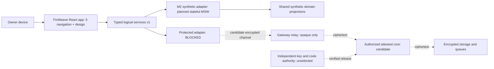
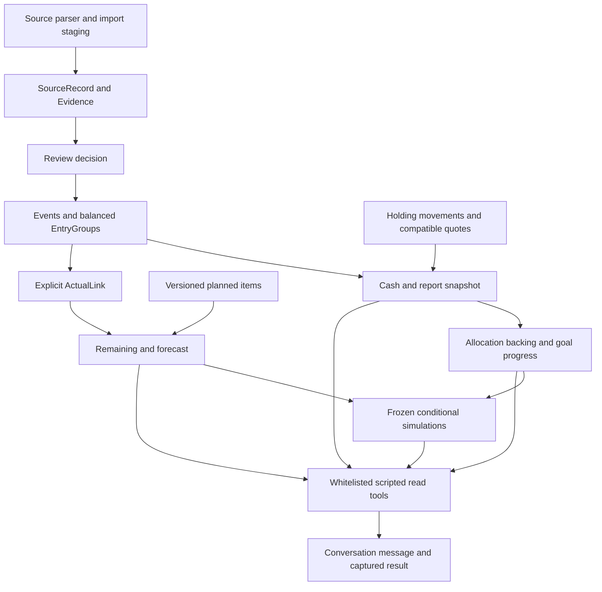
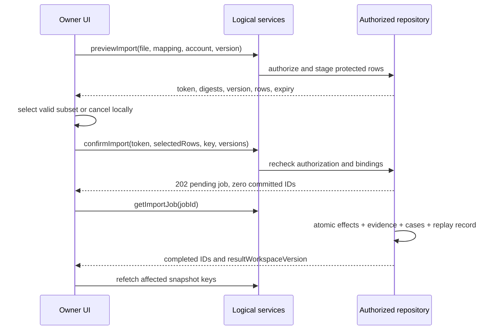
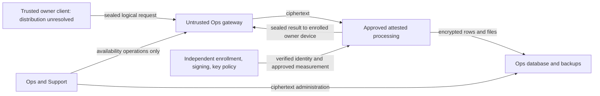

> Trạng thái hiện hành 06/10/2026: bước5 đã chuyển frontend sang stateful mock network contract1.1.0. Phần “planned/Step5pending” bên dưới giữ lịch sử thiết kế bước4; implementation thực tế, lựa chọn read model và giới hạn ở [ADR004](../adr/ADR-004-stateful-mock-and-read-model.md) và [Mock Implementation](../../frontend/mock-implementation.md). Real transport/security vẫn BLOCKED.

# Architecture Views v0.1

ARC-VIEW-001 · 06/10/2026 · logical target cho M2; “candidate” không là deployment đã có. [HLD](../high-level-design.md), [Security](../../security/security-design.md).

## V01 — Context và container



UI/Services/Engine code hiện cùng project; M1 MSW3 endpoints đang chạy, M2statefuladapter chưa wire. Protected adapter closed làcode thực; candidate relay/core/keyauthority/storage chưa tạo. Owners xemplaintext tại trusteddevice; relay/Ops không trở thành financialactor. No actualbank/LLM arrows vìM2scripted/fixture.

## V02 — Functional/modules/data view



Authoritative actualmoney: Events/EntryGroups; quantity/price source separate. Goalearmark/Plan/Simulation/AI không đượcpostactual. Reviewresolvedcasekhông bằng postedfinanceevent. Data22entities mapping ởDataModels. M2sharedmemory; real moduleexecution bênprotectedcore, nofinancialbusinesslogic bênrelay.

## V03 — Preview/confirm/import runtime



TrongM2bước5RsyntheticMSWmemory; realRrequiresattestedruntime/encryptedstorage. Duplicate retry returns samejob, khôngcopyledger. Conflict/expiredpreview giữinput→refetch/re-preview, noautoconfirm. Crash trướcatomiccommit→failed0 hoặc retryrunning; crash saucommit→completedack từreplayrecord.

## V04 — Deployment/trust/threat view



Noplaintextarrow từTEE→DB/Gateway/Ops. Threats cònunverified: operatorwritesbrowserJS, selfapproveskeypolicy, enrollsdevice/userimpersonation, debugsruntime, proxiesTLS, rollbacksnapshot/replayrequests, readscrashlogs. Attestationkhôngtự giải quyếtđườngclient/auth/recovery. Actortrustmatrix và test plan ởSecurityDesign, khôngdiagram tự chứngminhgate.

## V05 — AI capture/history sequence

```mermaid
sequenceDiagram
  participant P as Shared panel or full chat
  participant A as Assistant service
  participant E as Authorized read tools
  P->>P: capture nav, period, scope, filter, selected, versions
  P->>A: send message with context and key
  A-->>P: processing message ID
  A->>E: authorize explicit whitelisted read operation
  E-->>A: structured metrics, quality and evidence from captured version
  P->>P: navigate; current context may change
  P->>A: get message
  A-->>P: completed frozen result or failed with null result
  P->>P: label stale; drill with original context; privacy render
```

NoSQL/mutation/tool từprompt; M2scripted classifier nhậnintentởallowlist, textuntrustedkhôngchọnworkspace. Fullchat/history/panel dùngsameconversation ID. Cancellation vàterminalresult race kiểmmessageversion; khôngghi vàoresultđãcancelled.
