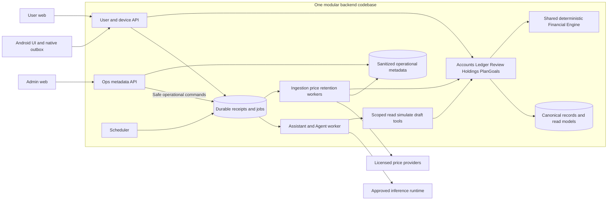
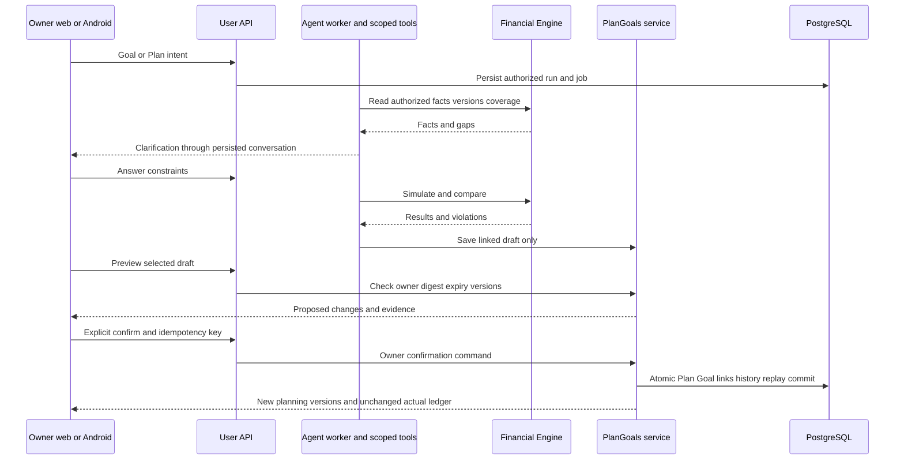
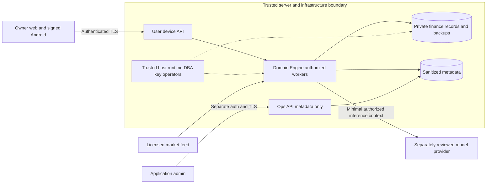
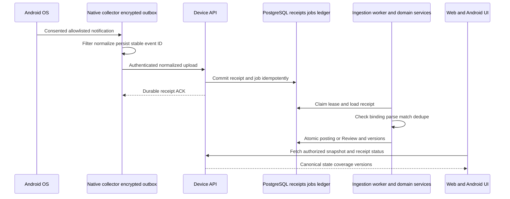
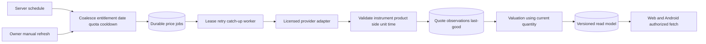

> **ARCH-13 hiện hành — 09/10/2026:** [Operations](../../operations/README.md) / [ADR020](../adr/ADR-020-local-first-operations-and-fenced-releases.md). API005 / DB005 / native003 giữ nguyên; local-first CI, release có bảo trì, backup/witness/alerts ngoài host. **DESIGN SPECIFIED; runtime/SQL/release/restore NOT RUN; REAL chưa bật.** Các notice revision cũ bên dưới là lịch sử; source/policy đích theo [bundle](../../operations/implementation-bundle.json).

> **ARCH-12 hiện hành — 09/10/2026:** [Agent LLD](../../agent/README.md) và [ADR019](../adr/ADR-019-bounded-agent-runtime-and-grounded-planning.md). Current **[API005](../../contracts/v2-t1-r5/README.md) / DB005 / native bridge003**, [bundle/hash](../../agent/implementation-bundle.json); Assistant mode/counter output delta, request/roles unchanged. **Design SPECIFIED; model disabled; runtime/evals NOT RUN.** Kế thừa AI-SPEC và các gói ARCH06–11 bằng explicit binding, không sửa historical packages/frontend.

> **ARCH-11 hiện hành — 09/10/2026:** [Sources](../../sources/README.md), [ADR018](../adr/ADR-018-verified-source-profiles-and-market-entitlements.md) và [bundle pin](../../sources/implementation-bundle.json). Chốt source profile/normalization/rights/consumer mapping; API004/DB005/bridge2 giữ nguyên. **Design SPECIFIED; REAL SOURCES NOT ACTIVATED; runtime NOT RUN.** ARCH11 làm rõ nguồn/binding/Review; notes ARCH05…10 là base và lịch sử, không evidence live support.

> **ARCH-10 hiện hành — 09/10/2026:** [Android design](../../android/README.md), [ADR017](../adr/ADR-017-android-native-collector-and-signed-apk.md) và [bundle pin](../../android/implementation-bundle.json). Capacitor/Kotlin, native identity/Room/Keystore/WorkManager, bridge2, support/clock/retention và signed APK. API004/DB005 giữ nguyên; frontend không sửa. **Design SPECIFIED; APK NOT BUILT, Android/runtime NOT RUN.** ARCH10 thay mô tả native cũ khi khác; notes ARCH05…09 là lịch sử và vẫn là base security/domain/async.

> **ARCH-09 hiện hành — 09/10/2026:** [Async/sync](../../async/README.md), [API004: 153 operations / 634 schemas](../../contracts/v2-t1-r4/README.md), [DB005: 87 bảng / 1001 cột](../../data/target-t1-async/README.md) và [bundle/hashes](../../async/implementation-bundle.json). Kế thừa đầy đủ tính năng; sửa CSV selectors và coverage paging, chốt J2/retry/ACK/scheduler/quota/cancellation/offline. **Thiết kế đã chốt; backend/SQL/native/provider/concurrency NOT RUN.** Các notes ARCH-05…08 bên dưới là lịch sử revision; target hiện hành theo004/005 và addenda này.

> **ARCH-08 hiện hành — 09/10/2026:** [Financial Engine/domain](../../domain/README.md), [API revision 003: 151 operations / 626 schemas](../../contracts/v2-t1-r3/README.md), [DB revision 004: 86 bảng / 988 cột](../../data/target-t1-domain/README.md) và [bundle/hashes](../../domain/implementation-bundle.json). Kế thừa T1/auth/security; bổ sung 4 operations dự báo và 2 bảng qua J2, không sửa prior packages, frontend hoặc snapshots. **Thiết kế đã chốt; Engine/SQL/concurrency/forecast thực tế NOT RUN.** Các notice ARCH-05…07 dưới đây giữ lịch sử revision; target hiện hành theo 003/004 và các addenda này.

> **ARCH-07 — 09/10/2026:** [Hồ sơ bảo vệ dữ liệu T1](../../security/t1/README.md), [bundle và hashes](../../security/t1/implementation-bundle.json), [schema đích 84 bảng / 960 cột](../../data/target-t1-security/README.md). API revision 002 giữ nguyên 147 operations; các gói và snapshot trước được giữ nguyên. Security profile bổ sung yêu cầu triển khai, không đổi payload API. SQL, bảo mật, backup, witness và restore thực tế đều **NOT RUN**; giữ đủ tính năng và 41 AC. Nội dung ARCH-07 hiện hành làm rõ các phần còn mở trong tài liệu kế thừa.

> **ARCH-06 current:** [Identity](../../security/identity/identity-access-design.md), [API002](../../contracts/v2-t1-r2/README.md), [DB identity](../../data/target-t1-auth/README.md), [ADR-013](../adr/ADR-013-first-party-identity-and-scoped-credentials.md). Target only; runtime NOT RUN.

# Architecture views v1.1

08/10/2026 · **ARCH-01 ACCEPTED: A + T1; ARCH-02 ACCEPTED: S1 + P2; ARCH-03 ACCEPTED: I0 + I1; ARCH-04 ACCEPTED: D1 + J2; ARCH-05 ACCEPTED CONTRACT DESIGN** · logical target chưa triển khai. [HLD](../high-level-design.md), [context](../../requirements/context-model.md), [ADR-008](../adr/ADR-008-modular-backend-trusted-server.md), [deployment](../deployment-topology.md), [module HLD](../module-high-level-design.md), [ADR-009](../adr/ADR-009-fastify-and-isolated-processes.md), [ADR-010](../adr/ADR-010-local-and-conditional-free-cloud.md). Oracle free VM là hướng cloud được chọn; chưa cấp host/IP/replicas.

## V1 — Ba clients, modules và workers

**P2:** user/device API và Ops API là hai processes riêng; worker profiles khác privilege chạy processes riêng, dùng chung domain package/Engine code, không microservices. Subgraph V1 là codebase dùng chung, không một process giữ mọi credentials. Ops không có finance pool; Agent không posting/active-plan-confirm credentials/tools. PG/Jobs/Safe có thể cùng PostgreSQL với roles/tables/schemas riêng. Tools→Domain chỉ cấp subset read/simulate/draft, không ledger write/confirm. Ingestion posting qua domain transaction; price không sửa cash/quantity. Ops không đọc private payload từ job queue.

## V2 — Agent draft và owner confirmation

UI exchanges đi qua authenticated API/persisted state, không yêu cầu worker mở socket tới user. Agent không có confirmation tool. Stale/conflict cần re-preview; replay committed key/digest trả prior result. Model calls ngoài DB transaction; manual planner vẫn hoạt động khi model unavailable.

## V3 — Trusted-server T1

Finance được xử lý dạng rõ trong T1; storage/backups và network vẫn phải mã hóa theo security design. Root/DBA/server key holder có khả năng đọc hoặc đổi runtime, đây là giới hạn trust owner đã chọn. App-admin không có quyền đó chỉ nhờ admin role. External inference cần privacy/egress decision riêng. Enclave/attestation/key authority độc lập không là gate bắt buộc T1.

## V4 — Receipt ACK khác posting

Lost ACK cho phép resend cùng ID; không ACK trước receipt commit. Transport replay khác semantic dedupe; crash/lease expiry không duplicate actual effects. Outbox chỉ bỏ sau durable ACK theo policy. Permission/force-stop/OEM gaps phải rõ; UI offline có thể chưa nhận version mới.

## V5 — Daily/manual quotes và lifecycle

Không transaction xuyên provider call. QuoteAsOf khác successful fetch time, missing không zero, không bịa lịch sử. Cash/quantity/income không đổi vì quote mới. Scheduler/worker cần runtime sống hoặc wake/catch-up được kiểm; host/free-tier reliability thuộc ARCH-03.

## V6 — Ownership và một ledger chuẩn

| Authority | State sở hữu | Consumers |
| --- | --- | --- |
| Accounts/Ledger | Opening, actual events/movements/corrections/history | Engine/read models/authorized UI; planning chỉ actual refs |
| Holdings/Market | Declarations/quantity, instruments/gold profiles/quotes | Engine valuation và asset UI |
| Ingestion/Review | Receipts/evidence/matching/dedupe/gaps | Validated ledger commands và Review UI; Ops chỉ sanitized status |
| PlanGoals | Planned items/Goals/links/allocations/drafts/history | Manual planner/simulation/scoped Agent tools |
| Assistant | Conversations/context refs/runs/steps/results | Shared user chat/panel/mascot, không admin prompt access |
| Jobs/Ops | Leases/retries/replay/operational projections | Bounded workers/safe Ops commands/redacted monitoring |

Ownership không bắt buộc mỗi module một DB. Transaction cần atomic giữ cùng consistency boundary; Engine là shared code. [BE-01…21](../../product/backend-backlog.md) đều giữ. Views không là runtime evidence hoặc quyền deploy; protected view v0.2 trong r1/r2 là lịch sử.

## V7 — Composition roots và capability isolation S1 + P2

| Composition root | Load và quyền | Lifecycle |
| --- | --- | --- |
| user-api | Authorized user/device use cases, typed routes, finance queries/owner confirmation; user/device DB role | HTTP process riêng, pool bounded, auth/log redaction |
| ops-api | Ops-only modules/auth/DTO/metadata và safe control requests; không finance pool/keys | HTTP process riêng; retry không proxy finance command hoặc private payload |
| worker profile | Chỉ job handlers/modules/capabilities/pool của ingestion-import/market/Agent/retention | Profiles khác quyền ở process riêng, lease/fence/retry/drain; scheduler enqueue không thay durable jobs |
| migrate | Reviewed SQL/checksum journal, DDL role riêng | One-off runner; credentials không cấp cho API/workers |

Root inject dependencies vào public module services/ports; shared code không là shared credentials. Financial Engine là pure library và cùng version giữa roots, không một HTTP service bắt buộc. TxContext giữ transaction cần atomic trong cùng PostgreSQL connection qua module owners. Xem [module HLD](../module-high-level-design.md) cho ownership54 bảng/dependencies và [Stack](../tech-stack.md) cho compiler/SQL/runtime direction.

V7 là design view dạng bảng, không proof runtime hoặc SQL grants đã triển khai. ARCH-03 chọn I0 + I1, nhưng quota/host/replicas/resource totals/ARM64 và worker boot còn cần kiểm/đo; P2 không yêu cầu một paid server mỗi process hoặc bảo đảm tổng chi phí0.

## V8 — Deployment/environment I0 + I1

| Lớp | I0 local | I1 Oracle Always Free có điều kiện |
| --- | --- | --- |
| Public ingress | Loopback/LAN test theo policy | HTTPS reverse proxy; user origin/API và admin origin/Ops tách |
| Compute | Processes/containers P2 | Một VM Linux ARM64, containers/processes có role/secrets/resource limits riêng |
| Persistence | Synthetic DB riêng, disposable test scope | Private PostgreSQL/persistent volume, durable jobs/receipts, không public DB port |
| Background | Host chạy thì timer/worker chạy | Timer enqueue, worker claim; restart catch-up, host chết thì schedule gián đoạn |
| Recovery | Export/restore test | Encrypted off-host exports, alert độc lập host; destination/restore chưa kiểm |
| Android/model | Signed test APK/scripted hoặc local PoC | HTTPS signed APK; model gateway riêng chưa chọn, không model public unauthenticated |

[Environment matrix](../environment-matrix.md) tách LOCAL-SYNTHETIC/STAGING-SYNTHETIC/REAL-T1. Trước real cần SEC-REAL-T1/source/model/native/UAT/restore evidence; khi có real, staging ở local hoặc host khác. Single-host không HA và free capacity/reclaim có rủi ro; không cấp được I1 thì giữ I0, không auto paid fallback. DNS/TLS/account/quota/sizing là checks trước provision, không endpoint đã có. R1/r2 không đổi.

## V9 — Persistence/transaction/dispatch D1 + J2

| Boundary | Facts/authority | Derived/operational | Quyền/atomicity |
| --- | --- | --- | --- |
| Actual | Events + sealed entry groups/posting lines + movement provenance | Home/report/cache | Ledger owner, financial effect+history+replay atomic |
| Planning | Stable scopes/revisions/items, active Plan/Goal state | Forecast/simulation/draft | Owner confirm; Agent draft-only; không actual |
| Ingestion/price/import/Agent | Domain receipt/refresh/import/run records | jobs/attempts/scheduler state | Typed reference, một lease authority; profile-specific fetch/finalize |
| History | Immutable input refs/versions/snapshot identity | projection_cache/payload TTL | Cache purge không mất pinned refs hoặc replay identities |
| Ops | Admin identity/session + sanitized metadata/control request | Ops summaries | Admin auth/business capabilities riêng, không finance credentials |
| Recovery/schema | Independent revoke/delete fence + migration journal | Local checkpoint copies | Dedicated trusted roles, restore gate trước workers/uploader |

[70-entity ERD](../../data/target-t1/erd.md), [dictionary](../../data/target-t1/data-dictionary.md), [permissions](../../data/target-t1/permissions.md), [ADR-011](../adr/ADR-011-evolving-schema-and-shared-jobs.md). Expand design141 FK includes110baseline; typed domain refs kiểm bởi narrow owner procedure, không giả FK. SQL/runtime/upgrade/restore NOT RUN.

## V10 — API consumers/authority/revision

| Caller | Credential/authority | Contract/cutover |
| --- | --- | --- |
| User browser | Owner cookie + Origin/CSRF | Core1.1.0/prototype2.0.0 adapters → working canonical revision |
| Android human UI | OwnerBearer lưu phía native | Cùng financial API; không fallback sang collector token |
| Kotlin collector | DeviceBearer, live binding/device/epochs | Chỉ ingestNotifications/reconcileReceipts; ACK khác posted |
| Admin web | Admin cookie/MFA/OpsIdentity | Sanitized Ops commands/outcome, không finance/impersonation |
| P2 worker profiles | Private mTLS AND signed nonce/body/path, capability + typed ticket | Kiểm workspace/domain/dispatch/generation/token/epoch |

[API141 operations](../../contracts/v2-t1/README.md), [fresh consumer mapping](../../contracts/v2-t1/consumer-operation-mapping.csv), [ADR-012](../adr/ADR-012-unified-t1-contract-revision.md). Pin revision/hash bắt buộc. ARCH-06 hoàn thiện credential storage/rotation/CSRF/key proof. Core DB target và frontend giữ nguyên; runtime tests NOT RUN.

## V11 — Identity và token authority (ARCH-06)

| Boundary | Authority | Không chuyển tiếp |
| --- | --- | --- |
| User web → user API | Host cookie + CSRF, owner workspace/object checks | Admin cookie, collector token, password trong logs |
| Native owner → user API | Owner access, refresh-purpose riêng, installation proof | Native secrets sang WebView; collector key thành owner |
| Native collector → ingestion/renewal | Collector bearer, collector-key rotation proof, live consent/epochs | Finance read/Plan confirm/owner refresh |
| Admin web → Ops API | Separate cookie + TOTP + fresh reauth | Owner credentials/finance/impersonation |
| P2 services → internal API | Private mTLS AND per-principal MAC/nonce + typed ticket | Public internal routes/arbitrary worker role |

Reset không là backup/Keystore recovery; restored sessions không tự sống lại. [Protocol](../../security/identity/identity-access-design.md), [147-operation matrix](../../security/identity/operation-permissions.csv).

## V12 — Storage, backup và recovery theo T1

| Ranh giới | Dữ liệu/điều khiển | Quyền và giới hạn |
| --- | --- | --- |
| P2 runtime → volume PostgreSQL mã hóa | Bản ghi tài chính; secret ciphertext/digest theo mục đích | Root/DBA/runtime được tin vẫn có khả năng đọc plaintext |
| Backup reader → repository ngoài host | Export nhất quán, mã hóa; không chứa khóa để tự mở recovery capsule | Source writer không được xóa; credential prune nằm ngoài finance host |
| Recovery coordinator → witness độc lập | Metadata thu hồi/xóa có chữ ký; không có finance | Head mới nhất gắn nonce; chỉ deny, không cấp lại quyền |
| Custodian offline → recovery capsule | Khóa recovery có version, mã hóa bằng age | Khóa recipient tách khỏi capsule và backup; tránh phụ thuộc vòng tròn |
| Restore cách ly → mở lại hệ thống | Chặn host cũ, kiểm witness và áp dụng deny, thay credentials, kiểm domain | Thiếu bằng chứng thì LOCKED; không cam kết HA hoặc zero loss |

[Protocol](../../security/t1/backup-restore-erasure.md), [threat model](../../security/t1/threat-model.md), [phân loại 84 bảng](../../security/t1/table-data-classification.csv).

## V13 — Engine và forecast run

| Boundary | Input/output | Authority/invariant |
| --- | --- | --- |
| Owner/API → application UoW → Engine | Authorized typed facts + versions + clock → effects/draft/projection | Một ledger, exact money, workspace locks; không Engine tự authenticate/commit |
| Posted ledger/quantity/quotes → snapshot | Business cutoff + recorded version + scope + dependency refs | Không future price/mixed versions; unknown khác0; cache rebuild được |
| Plan–Goals/Agent → simulation/draft | Shared funding, recurrence, lineage, assumptions | Không double-spend; draft không active/funded/actual |
| startForecastRun → J2 → ForecastWorker | Freeze snapshot/settings/seed → bounded compute chunks/checkpoint | Compute-only; no provider/model/actual call; current fence |
| Staged pages → succeeded → web/mobile/tools | Complete trials, immutable digests, current-authorized paged results | Không partial probability, stale lease publish hoặc expired run tự rerun |

[Engine/domain](../../domain/README.md), [forecast](../../domain/forecast-model.md), [transaction protocol](../../domain/transactions-and-concurrency.md). Runtime NOT RUN.

## ARCH-09 — V14 — Async/sync

Sơ đồ sequence/state ở hồ sơ async chỉ rõ native durable ACK khác actual posted, provider I/O ngoài transaction, live fence khi publish và cancel/finish race. Current API004153operations/634schemas và DB00587bảng/1001cột/162FK là thiết kế, không runtime.

[Hồ sơ async](../../async/README.md), [API004](../../contracts/v2-t1-r4/README.md), [DB005](../../data/target-t1-async/README.md), [ADR-016](../adr/ADR-016-postgresql-dispatch-and-explicit-sync-outcomes.md), [32 ca runtime](../../async/acceptance-plan.md).

## ARCH-10 — Android implementation handover

Deployment: bundled owner UI→typed bridge→native identity/owner HTTP; listener→encrypted Room→scoped WorkManager→API receipt→Engine. Trust: same-origin XSS can still invoke normal owner capabilities, fresh reauth/native confirmation for high risk.

[Chi tiết Android](../../android/README.md) · [Acceptance32 NOT RUN](../../android/acceptance-plan.md) · [Báo cáo ARCH10](../ARCH-10-change-report.md).

## ARCH-11 — Source integration handover

Notification→native profile/binding→normalized receipt→Engine/Review; provider→MarketQuota/rights→quote observation→valuation snapshot→user. Admin chỉ health projection; Agent chỉ scoped allowed derived fields theo cả privacy và source license.

[Source design](../../sources/README.md) · [Acceptance32 NOT RUN](../../sources/acceptance-plan.md) · [Báo cáo ARCH11](../ARCH-11-change-report.md).

## ARCH-12 — Agent runtime handover

User API→frozen message/run/J2→AgentWorker→private ModelAdapter→validated ToolGateway→Engine/Planning draft→GroundedRenderer→same conversation. API/model/actual trust boundaries giữ T1, no Agent owner-confirm.

[Runtime design](../../agent/README.md) · [Acceptance32 NOT RUN](../../agent/acceptance-plan.md) · [Báo cáo ARCH12](../ARCH-12-change-report.md).

## ARCH-13 — Operations handover

Luồng phát hành: build/test/sign cùng artifact→maintenance→drain/fence→migration→readiness/smoke riêng→workers/scheduler→mở cổng. Backup/witness/alerts ngoài host; không claim HA hoặc zero downtime.

[Hồ sơ vận hành](../../operations/README.md) · [Acceptance32 NOT RUN](../../operations/acceptance-plan.md) · [Báo cáo](../ARCH-13-change-report.md).
