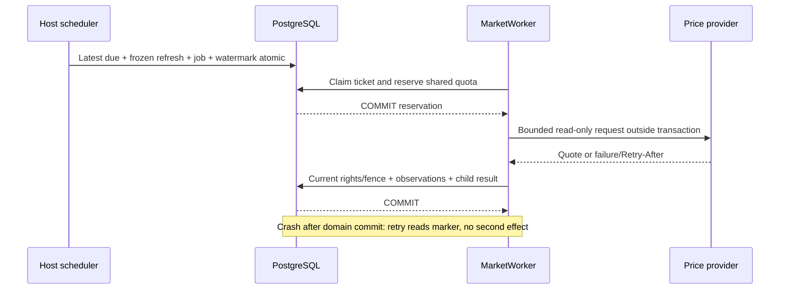
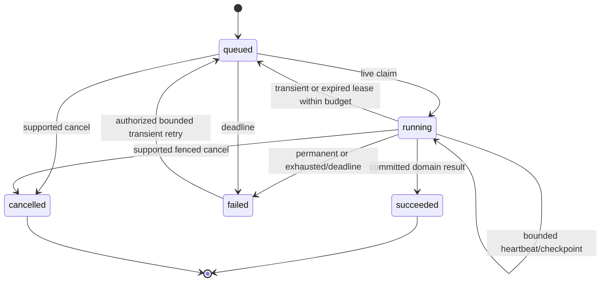

# Sequence và state boundaries

**DESIGN / NOT EXECUTED.** Các sơ đồ mô tả commit points, không là bằng chứng chạy.

```mermaid
sequenceDiagram
    participant N as Android native
    participant A as User/device API
    participant D as PostgreSQL
    participant W as IngestionWorker
    participant U as User web/mobile
    N->>N: Parse/redact, encrypted outbox, fixed identity
    N->>A: Batch exact identity/digest/epochs
    A->>D: Auth + receipt + evidence + J2 job in one transaction
    D-->>A: COMMIT
    A-->>N: Durable per-item ACK
    N->>N: Move to bounded ACK journal
    W->>D: Claim live typed ticket
    W->>W: Parse/match outside transaction
    W->>D: Recheck fence + atomic effect/Review + result
    D-->>W: COMMIT
    U->>A: Query typed receipt + financial projection
    A-->>U: Posted or Review; ACK alone adds no money
```





Job succeeded nghĩa delivery step đã tạo durable domain result; receipt needs_review, Agent awaiting_user và import completed-with-Review có thể tương ứng job succeeded. Không ép các domain đó thành actual posted/completed run. Failed→queued không áp dụng nếu permanent/deadline/cancelled/committed; sơ đồ không thay guards trong [transition registry](job-transitions.csv).

Forecast/cancel race: dưới cùng run/job locks, succeeded commit trước→giữ succeeded; cancelRequested commit trước→no new checkpoint/publication, supervisor/reaper chốt cancelled. Old-generation hoặc old-host worker không publish dù compute vẫn còn chạy. Restore/witness gate chặn tất cả trước khi reopen queues; missing receipt chỉ dẫn investigation.
