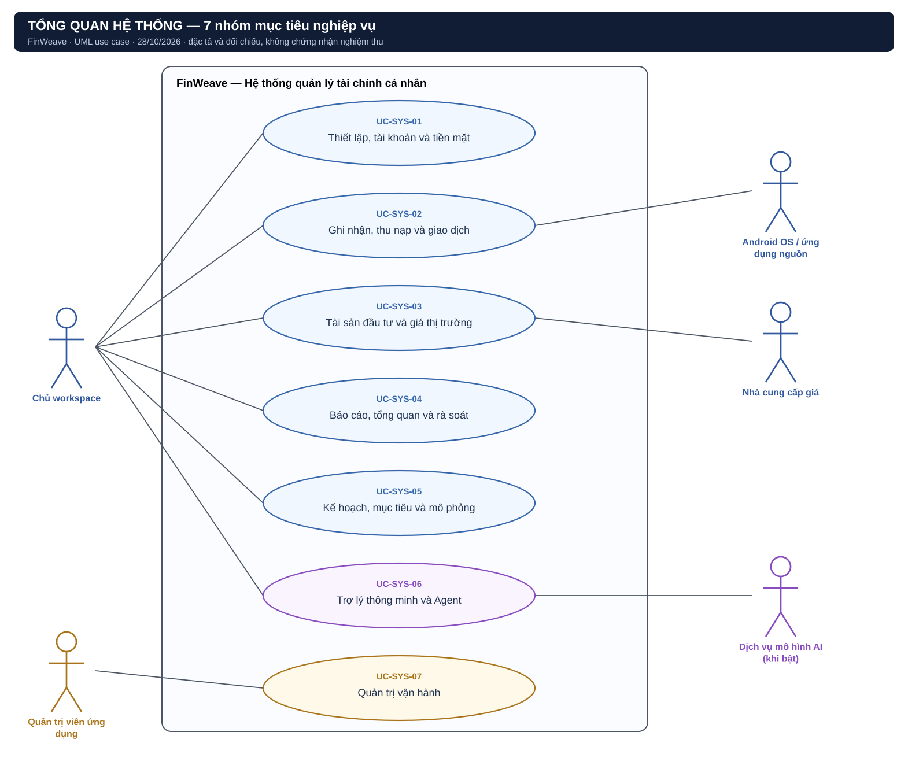
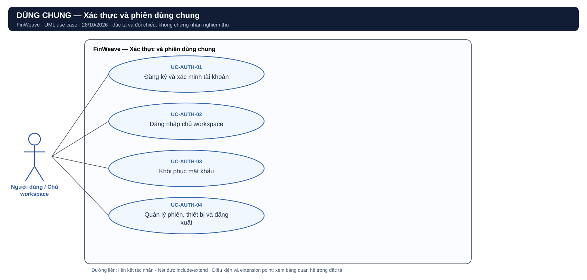
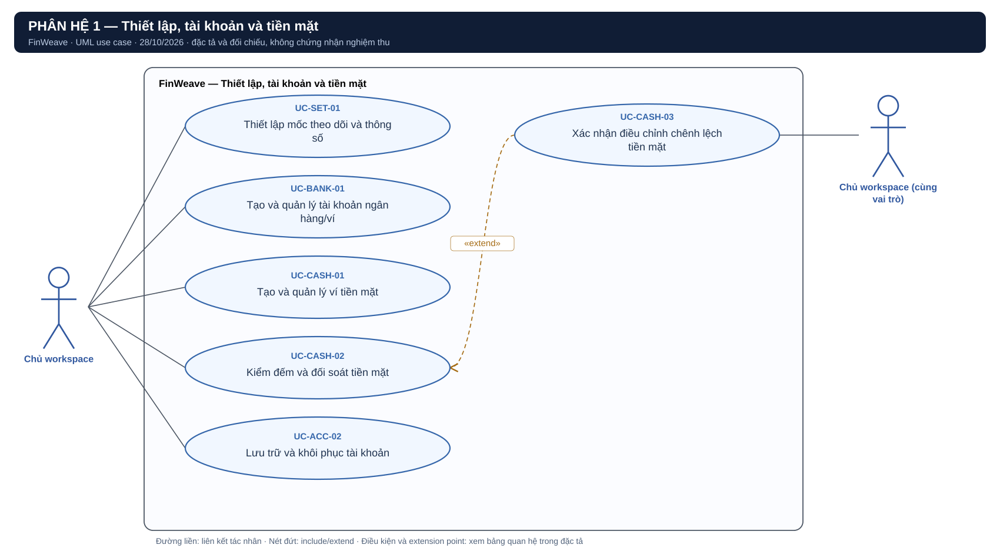
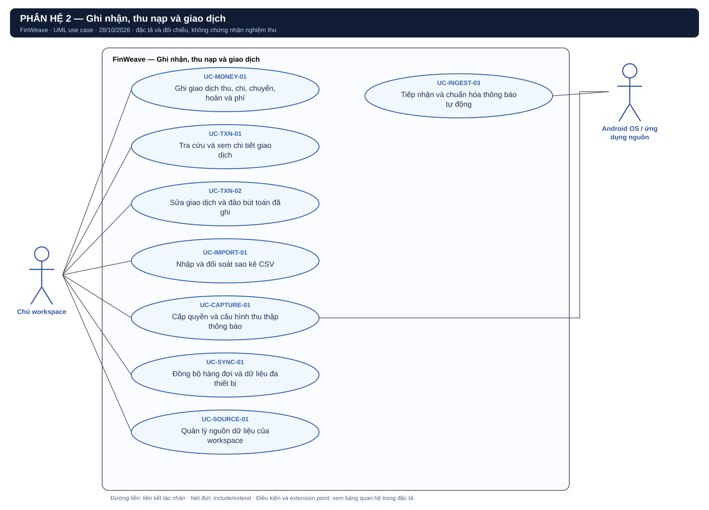
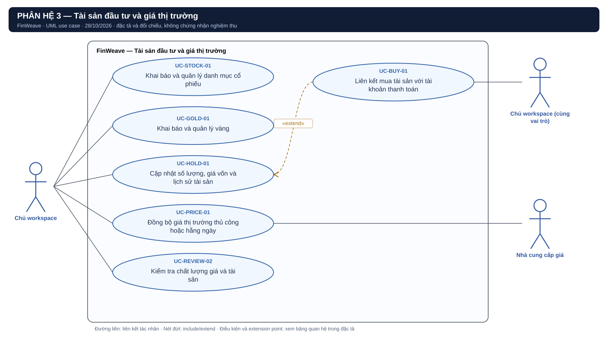
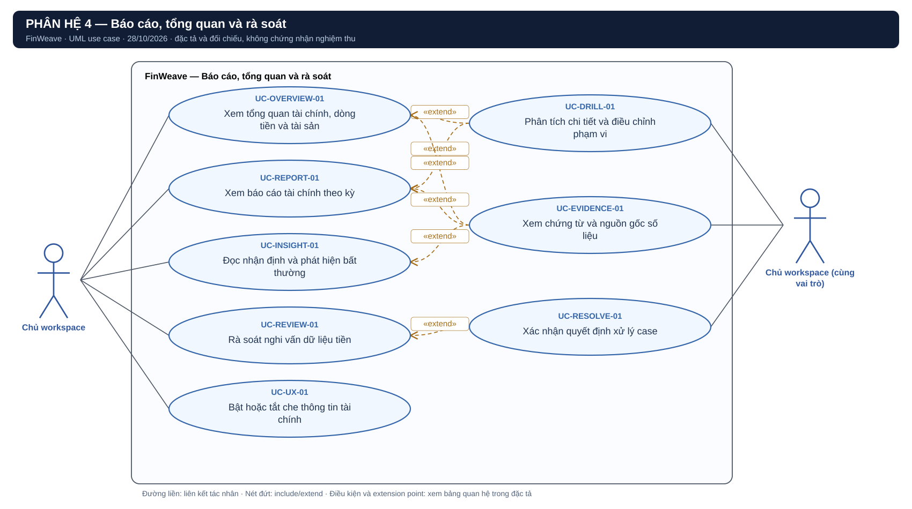
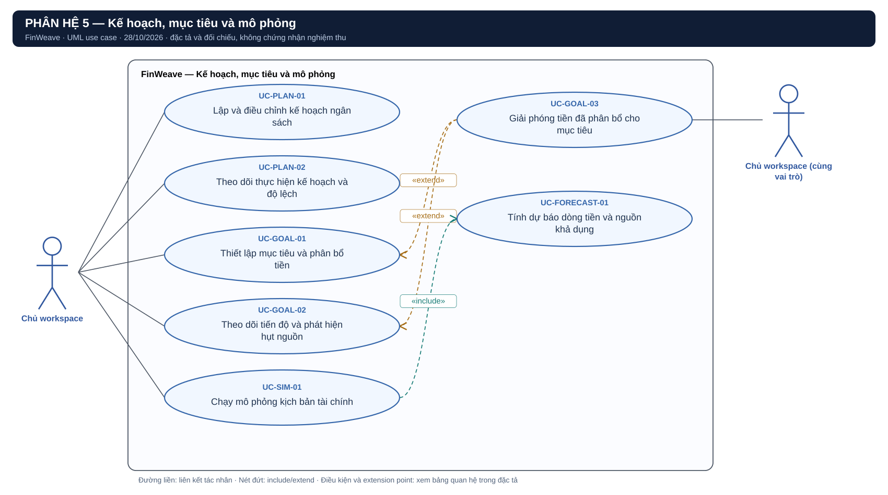
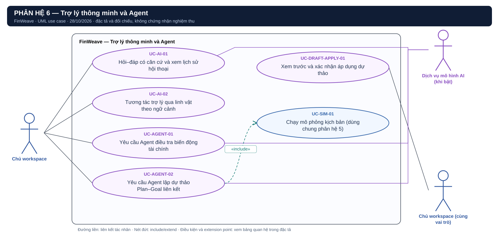
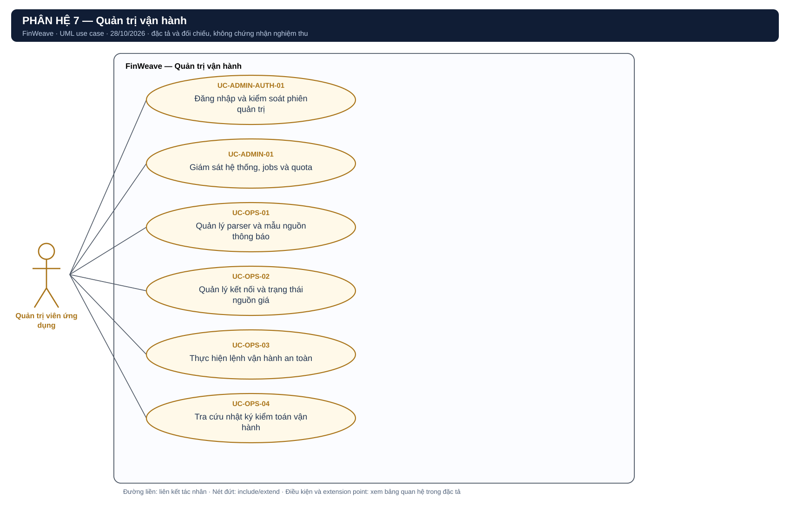

# FinWeave — Danh mục và sơ đồ

Ngày: 28/10/2026. Bảy nhóm nghiệp vụ được giữ theo hình tham chiếu; bổ sung sơ đồ xác thực dùng chung. Hình #9 được dùng làm điểm xuất phát cho mức tổng quan; hình #2 là bản trình bày trùng mức, không thêm bảy ca mới.

## Tác nhân và ranh giới

| Tác nhân | Vai trò |
|---|---|
| Chủ workspace | Thực hiện nghiệp vụ tài chính của chính workspace được phép |
| Người dùng chưa đăng nhập | Đăng ký, đăng nhập và yêu cầu khôi phục tài khoản |
| Quản trị viên ứng dụng | Chỉ thao tác metadata/lệnh vận hành được cấp; không đọc finance owner |
| Android OS và ứng dụng nguồn | Cung cấp notification qua collector; ứng dụng ngân hàng không mặc nhiên có API trực tiếp với FinWeave |
| Nhà cung cấp giá | Trả quote qua adapter có profile/entitlement được duyệt |
| Dịch vụ mô hình AI | Tác nhân hỗ trợ khi model mode được bật; scripted demo không là LLM thật |
| Dịch vụ email | Gửi challenge cho owner; thể hiện trong đặc tả xác thực, lược trên sơ đồ để gọn |

Collector, worker, scheduler, Engine, database, linh vật và AI Agent nội bộ đều nằm trong ranh giới FinWeave khi xét toàn hệ thống. Scheduler nội bộ kích hoạt daily refresh bằng time event; không bắt buộc vẽ nó là tác nhân ngoài. Host operator/root/DBA có trust khác app-admin; backup/migrate/restore CLI không mặc nhiên thuộc quyền actor app-admin.

## Bộ sơ đồ

### Xác thực dùng chung — Xác thực và phiên dùng chung

[PlantUML có thể chỉnh sửa](diagrams/00-auth.puml) · [PNG](diagrams/00-auth.png)

### Phân hệ 1 — Thiết lập, tài khoản và tiền mặt

[PlantUML có thể chỉnh sửa](diagrams/01-accounts.puml) · [PNG](diagrams/01-accounts.png)

### Phân hệ 2 — Ghi nhận, thu nạp và giao dịch

[PlantUML có thể chỉnh sửa](diagrams/02-transactions.puml) · [PNG](diagrams/02-transactions.png)

### Phân hệ 3 — Tài sản đầu tư và giá thị trường

[PlantUML có thể chỉnh sửa](diagrams/03-assets.puml) · [PNG](diagrams/03-assets.png)

### Phân hệ 4 — Báo cáo, tổng quan và rà soát

[PlantUML có thể chỉnh sửa](diagrams/04-reports.puml) · [PNG](diagrams/04-reports.png)

### Phân hệ 5 — Kế hoạch, mục tiêu và mô phỏng

[PlantUML có thể chỉnh sửa](diagrams/05-planning.puml) · [PNG](diagrams/05-planning.png)

### Phân hệ 6 — Trợ lý thông minh và Agent

[PlantUML có thể chỉnh sửa](diagrams/06-assistant.puml) · [PNG](diagrams/06-assistant.png)

### Phân hệ 7 — Quản trị vận hành

[PlantUML có thể chỉnh sửa](diagrams/07-operations.puml) · [PNG](diagrams/07-operations.png)

## Danh mục 50 ca chi tiết

| ID | Tên | Nhóm | Truy vết |
|---|---|---|---|
| UC-AUTH-01 | Đăng ký và xác minh tài khoản | Dùng chung | REQ-SURFACE-01; SRS NFR identity; identity-access-design.md |
| UC-AUTH-02 | Đăng nhập chủ workspace | Dùng chung | REQ-SURFACE-01 / AC-29; identity-access-design.md |
| UC-AUTH-03 | Khôi phục mật khẩu | Dùng chung | identity-access-design.md; NFR-07/19 |
| UC-AUTH-04 | Quản lý phiên, thiết bị và đăng xuất | Dùng chung | REQ-SURFACE-01 / AC-29; REQ-SYNC-01 / AC-33 |
| UC-SET-01 | Thiết lập mốc theo dõi và thông số | 1 | REQ-SET-01 / AC-01 |
| UC-BANK-01 | Tạo và quản lý tài khoản ngân hàng/ví | 1 | REQ-BANK-01 / AC-02 |
| UC-CASH-01 | Tạo và quản lý ví tiền mặt | 1 | REQ-CASH-01 / AC-03 |
| UC-CASH-02 | Kiểm đếm và đối soát tiền mặt | 1 | REQ-CASH-02 / AC-09 |
| UC-CASH-03 | Xác nhận điều chỉnh chênh lệch tiền mặt | 1 | Refinement REQ-CASH-02 / AC-09 |
| UC-ACC-02 | Lưu trữ và khôi phục tài khoản | 1 | Tách từ UC-DRILL-01 cũ; REQ-DRILL-01 / AC-14 |
| UC-MONEY-01 | Ghi giao dịch thu, chi, chuyển, hoàn và phí | 2 | REQ-MONEY-01 / AC-08 |
| UC-TXN-01 | Tra cứu và xem chi tiết giao dịch | 2 | REQ-TXN-01 / AC-11 |
| UC-TXN-02 | Sửa giao dịch và đảo bút toán đã ghi | 2 | REQ-TXN-02 / AC-12 |
| UC-IMPORT-01 | Nhập và đối soát sao kê CSV | 2 | REQ-INPUT-01 / AC-06 |
| UC-CAPTURE-01 | Cấp quyền và cấu hình thu thập thông báo | 2 | REQ-CAPTURE-01 / AC-31; REQ-APK-01 / AC-30 |
| UC-INGEST-03 | Tiếp nhận và chuẩn hóa thông báo tự động | 2 | REQ-INGEST-03 / AC-32 |
| UC-SYNC-01 | Đồng bộ hàng đợi và dữ liệu đa thiết bị | 2 | REQ-SYNC-01 / AC-33; REQ-RECOVERY-01 / AC-41 |
| UC-SOURCE-01 | Quản lý nguồn dữ liệu của workspace | 2 | REQ-INPUT-02 / AC-07; REQ-CAPTURE-01/PRICE-01 |
| UC-STOCK-01 | Khai báo và quản lý danh mục cổ phiếu | 3 | REQ-STOCK-01/02 / AC-04/34 |
| UC-GOLD-01 | Khai báo và quản lý vàng | 3 | REQ-GOLD-01/02 / AC-05/35 |
| UC-HOLD-01 | Cập nhật số lượng, giá vốn và lịch sử tài sản | 3 | REQ-HOLD-01 / AC-10 |
| UC-BUY-01 | Liên kết mua tài sản với tài khoản thanh toán | 3 | Refinement REQ-HOLD-01 / AC-10 |
| UC-PRICE-01 | Đồng bộ giá thị trường thủ công hoặc hằng ngày | 3 | REQ-PRICE-01 / AC-36 |
| UC-REVIEW-02 | Kiểm tra chất lượng giá và tài sản | 3 | REQ-REVIEW-02 / AC-16 |
| UC-OVERVIEW-01 | Xem tổng quan tài chính, dòng tiền và tài sản | 4 | REQ-OVERVIEW-01 / AC-13 |
| UC-REPORT-01 | Xem báo cáo tài chính theo kỳ | 4 | REQ-REPORT-01 / AC-20 |
| UC-DRILL-01 | Phân tích chi tiết và điều chỉnh phạm vi | 4 | REQ-DRILL-01 / AC-14 |
| UC-INSIGHT-01 | Đọc nhận định và phát hiện bất thường | 4 | REQ-INSIGHT-01 / AC-21 |
| UC-REVIEW-01 | Rà soát nghi vấn dữ liệu tiền | 4 | REQ-REVIEW-01 / AC-15 |
| UC-RESOLVE-01 | Xác nhận quyết định xử lý case | 4 | Refinement REQ-REVIEW-01 / AC-15 |
| UC-EVIDENCE-01 | Xem chứng từ và nguồn gốc số liệu | 4 | Refinement REQ-TXN-01/OVERVIEW-01/INSIGHT-01 |
| UC-UX-01 | Bật hoặc tắt che thông tin tài chính | 4 | REQ-UX-01 / AC-17; NFR-12 |
| UC-PLAN-01 | Lập và điều chỉnh kế hoạch ngân sách | 5 | REQ-PLAN-01 / AC-22 |
| UC-PLAN-02 | Theo dõi thực hiện kế hoạch và độ lệch | 5 | REQ-PLAN-02 / AC-23 |
| UC-GOAL-01 | Thiết lập mục tiêu và phân bổ tiền | 5 | REQ-GOAL-01 / AC-24 |
| UC-GOAL-02 | Theo dõi tiến độ và phát hiện hụt nguồn | 5 | REQ-GOAL-02 / AC-25 |
| UC-GOAL-03 | Giải phóng tiền đã phân bổ cho mục tiêu | 5 | Refinement REQ-GOAL-01/02 / AC-24/25 |
| UC-SIM-01 | Chạy mô phỏng kịch bản tài chính | 5 | REQ-SIM-01 / AC-26 |
| UC-FORECAST-01 | Tính dự báo dòng tiền và nguồn khả dụng | 5 | Refinement REQ-SIM-01; domain forecast-model.md |
| UC-AI-01 | Hỏi–đáp có căn cứ và xem lịch sử hội thoại | 6 | REQ-AI-01 / AC-27; AI-FR-001…007/009/019…021/023 |
| UC-AI-02 | Tương tác trợ lý qua linh vật theo ngữ cảnh | 6 | REQ-AI-02 / AC-28; AI-FR-004…008/019 |
| UC-AGENT-01 | Yêu cầu Agent điều tra biến động tài chính | 6 | REQ-AGENT-01/03 / AC-38/40; AI-SPEC INV-01 |
| UC-AGENT-02 | Yêu cầu Agent lập dự thảo Plan–Goal liên kết | 6 | REQ-AGENT-02/03 / AC-39/40; AI-SPEC PG-01/02/03 |
| UC-DRAFT-APPLY-01 | Xem trước và xác nhận áp dụng dự thảo | 6 | Refinement REQ-AGENT-02 / AC-39; AI-FR-014…016/022…024 |
| UC-ADMIN-AUTH-01 | Đăng nhập và kiểm soát phiên quản trị | 7 | REQ-ADMIN-01 / AC-37; REQ-SURFACE-01 / AC-29 |
| UC-ADMIN-01 | Giám sát hệ thống, jobs và quota | 7 | REQ-ADMIN-01 / AC-37 |
| UC-OPS-01 | Quản lý parser và mẫu nguồn thông báo | 7 | REQ-ADMIN-01 / AC-37 |
| UC-OPS-02 | Quản lý kết nối và trạng thái nguồn giá | 7 | REQ-ADMIN-01 / AC-37; REQ-PRICE-01 / AC-36 |
| UC-OPS-03 | Thực hiện lệnh vận hành an toàn | 7 | REQ-ADMIN-01 / AC-37; REQ-RECOVERY-01 / AC-41 |
| UC-OPS-04 | Tra cứu nhật ký kiểm toán vận hành | 7 | REQ-ADMIN-01 / AC-37 |

Các vai trò “Chủ workspace” xuất hiện hai lần ở vài hình chỉ để tránh đường giao cắt; chúng là **cùng một actor**, không phải hai loại người dùng. Mỗi ID dùng duy nhất một định nghĩa; UC-SIM-01 xuất hiện lại tại phân hệ 6 để chỉ hành vi dùng chung, không tạo mô phỏng thứ hai. Hình SVG được dựng trực tiếp từ model JSON; PlantUML chứa cùng các ca và quan hệ, bố cục có thể khác khi render.
