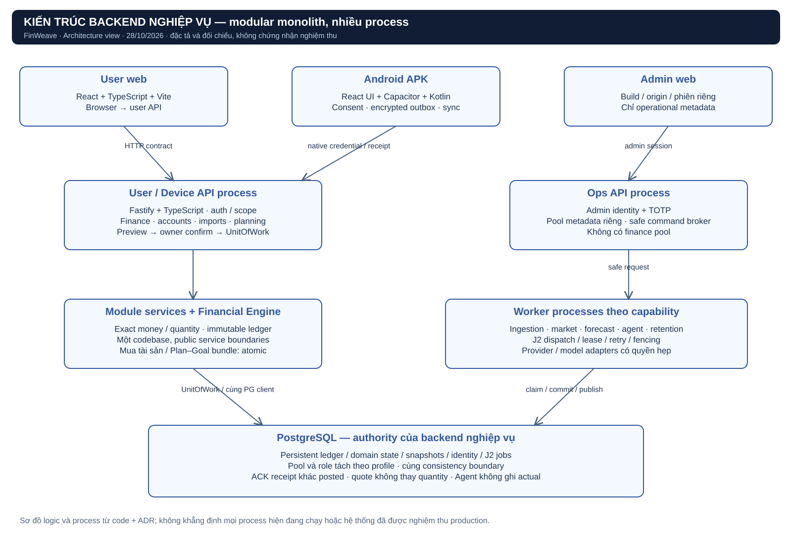
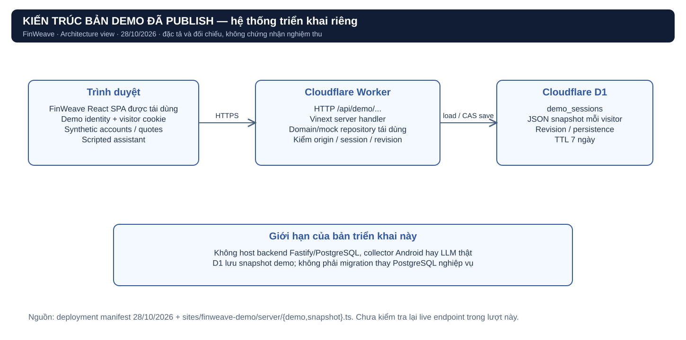

# FinWeave — Kiến trúc hệ thống đang sử dụng

Đối chiếu ngày 28/10/2026 bằng tài liệu và mã nguồn trong workspace. Lượt này kiểm tra tĩnh, không khởi chạy database, không thử lại provider/model và không xác minh tình trạng endpoint đang online. Những kết quả PASS dưới đây là kết quả **đã được ghi trong báo cáo dự án**, không phải kiểm thử mới của lượt phân tích này.

## 1. Kết luận kiến trúc

**Backend nghiệp vụ FinWeave được thiết kế theo modular monolith, tổ chức theo lớp và chạy nhiều process có quyền riêng.** Frontend dùng mô hình client–server; các pipeline thu nạp, giá và Agent xử lý bất đồng bộ bằng durable jobs trên PostgreSQL. Có nhiều process không đồng nghĩa đã chuyển thành microservices: domain dùng chung codebase, database và ranh giới nhất quán, các thay đổi liên quan có thể commit trong cùng transaction.

**Bản demo đã publish là một nhánh triển khai riêng dùng Cloudflare Workers + D1.** Nó tái dùng giao diện, domain commands và repository mô phỏng; có lưu bền demo qua HTTP nhưng không host backend nghiệp vụ PostgreSQL, collector Android hoặc LLM thật. Vì vậy khi thuyết trình cần nói rõ đang mô tả backend nghiệp vụ hay bản demo đang trình diễn.

Nguồn quyết định thiết kế: [ADR-008](../architecture/adr/ADR-008-modular-backend-trusted-server.md), [ADR-009](../architecture/adr/ADR-009-fastify-and-isolated-processes.md), [module HLD](../architecture/module-high-level-design.md). Nguồn bản demo: [deployment manifest 28/10](../../artifacts/cloud-demo-deployment-2026-10-28.json), [README demo](../../sites/finweave-demo/README.md), [demo server](../../sites/finweave-demo/server/demo.ts).

## 2. Ba cấu hình cần phân biệt

| Cấu hình | Giao diện / server | Nơi giữ dữ liệu | AI / nguồn | Ý nghĩa bằng chứng |
|---|---|---|---|---|
| Prototype `synthetic_mock` | React; mock network bằng MSW hoặc native synthetic adapter | Repository mô phỏng theo cấu hình prototype | Fixture, scripted behavior | Kiểm hành vi giao diện và quy tắc synthetic |
| Backend nghiệp vụ `synthetic-local` | React web/admin → Fastify; Android có adapter native | PostgreSQL; ledger/domain/identity/jobs và version | Provider stub, deterministic Agent; adapter model có gate riêng | Có code thực và báo cáo kiểm thử HTTP/PG local; chưa là production/nguồn thật |
| Hosted `cloud-demo` | SPA tái dùng → HTTP demo routes → Cloudflare Worker | D1 `demo_sessions`, JSON snapshot theo visitor | Ví dụ tài chính và scripted assistant | Demo HTTP có persistence/isolation; không thay thế kiểm thử backend nghiệp vụ |

Frontend chọn mode tại [main.tsx](../../finweave-web/src/main.tsx) và [services/api.ts](../../finweave-web/src/services/api.ts). Backend loader [config.ts](../../finweave-backend/src/runtime/config.ts) chỉ cho `FW_MODE=synthetic-local`, kiểm profile và loopback; do đó có mã backend không chứng minh đang nhận dữ liệu thật. Không có cơ chế được phép lấy mock success để che lỗi HTTP trong backend mode.

## 3. Các thành phần của backend nghiệp vụ

| Thành phần | Trách nhiệm | Dẫn chứng mã nguồn |
|---|---|---|
| User web | Tài khoản, giao dịch, Home/báo cáo, Plan/Goals, trợ lý; query và command theo contract | [frontend bootstrap](../../finweave-web/src/main.tsx), [API transport](../../finweave-web/src/services/api.ts) |
| Admin web | Giao diện vận hành riêng, không phải trang tài chính owner đổi role | [admin bootstrap](../../finweave-web/admin), [Vite admin config](../../finweave-web/vite.admin.config.ts) |
| Android APK | React UI trong Capacitor; Kotlin xử lý notification, native identity, local outbox và upload | [native bootstrap](../../finweave-web/src/native/bootstrap.ts), [collector Kotlin](../../finweave-web/android/app/src/main/java/test/finweave/prototype/collector) |
| User/device API | Fastify routes, auth, validation, scope, orchestration nghiệp vụ | [app.ts](../../finweave-backend/src/runtime/app.ts) |
| Ops API | Admin session/MFA; đọc metadata, phát safe command; pool identity và pool Ops metadata riêng | [app.ts](../../finweave-backend/src/runtime/app.ts), [ops-business.ts](../../finweave-backend/src/runtime/ops-business.ts) |
| Domain services | Finance, accounts/workspace, business, imports, sources, assistant, planning drafts | [runtime](../../finweave-backend/src/runtime) |
| Financial Engine | Tính tiền, quantity, posting, funding và mô phỏng; số liệu tài chính không lấy từ văn bản model | [engine](../../finweave-backend/src/engine), [exact.ts](../../finweave-backend/src/engine/exact.ts) |
| Worker profiles | Ingestion/market/forecast/agent/retention; lease/retry/checkpoint/fencing theo capability | [main.ts](../../finweave-backend/src/runtime/main.ts), [worker.ts](../../finweave-backend/src/runtime/worker.ts), [async-pipeline.ts](../../finweave-backend/src/runtime/async-pipeline.ts) |
| PostgreSQL + UnitOfWork | Canonical ledger, state, phiên bản, identity, J2 jobs; transaction dùng cùng PG client | [uow.ts](../../finweave-backend/src/runtime/uow.ts), [database](../../finweave-backend/database) |

Tên thư mục `runtime` hiện gom nhiều service thành file, không thể chỉ từ sơ đồ HLD mà khẳng định toàn bộ code đã được tách package đúng Clean Architecture/DDD. Có thể mô tả phân lớp logic là **presentation → application services → domain/Engine → persistence/adapters**. Mức tuân thủ import boundaries toàn repo chưa được audit trong lượt này.

### Công nghệ đọc trực tiếp từ dự án

| Phần | Công nghệ hiện có | Vai trò |
|---|---|---|
| Frontend | React 19.3.0, TypeScript 5.9.3, Vite 8.3.2; React Router, TanStack Query, Zod, ECharts | SPA, routing, state/query, validation và biểu đồ |
| Backend | Node 24.19.x theo engines, Fastify 5.12.5, `pg` 8.23.1, AJV | HTTP runtime, PostgreSQL driver, schema validation |
| Database | PostgreSQL 16; gói local embedded 16.14 | Database quan hệ và durable dispatch; phiên bản server từng chạy phải đối chiếu receipt |
| Android | Capacitor Android/core 8.5.3; Kotlin, Room, Keystore, WorkManager | Native lifecycle, encrypted outbox, background sync |
| Tiền và số lượng | Exact kernel với BigInt/rational; decimal wire giữ string; PostgreSQL numeric | Tránh sai số float ở actual financial effects |
| Hosted demo | Cloudflare Worker, Vinext handler, Cloudflare D1 | Chạy demo server và lưu snapshot visitor |

Các phiên bản là giá trị trong [package frontend](../../finweave-web/package.json), [package backend](../../finweave-backend/package.json) và code hiện có; không phải khuyến nghị “phiên bản mới nhất”. `decimal.js` có trong frontend không có nghĩa mọi phép tính actual backend dùng thư viện đó; backend exact kernel hiện có BigInt/rational. Forecast có thể dùng phép toán xấp xỉ với output simulated được gắn nhãn. Không gộp tính toán mô phỏng và ledger actual thành cùng mức đảm bảo.

### Cách tách process và quyền

[main.ts](../../finweave-backend/src/runtime/main.ts) chọn bootstrap bằng profile: user, ops hoặc worker; workers không mở public API như user/ops. User API và Ops API có lifecycle/credential/pool riêng theo thiết kế P2. Agent/market/ingestion/forecast/retention có capability khác nhau; process chỉ là một phần của isolation, còn cần grants và validation phía database.

Ops có hai pool phục vụ identity và metadata vận hành, **không có finance pool**. [app.ts](../../finweave-backend/src/runtime/app.ts) kiểm role membership và chặn role có quyền finance/DDL hoặc ghép quyền không đúng. “Tách pool” ở đây không có nghĩa mỗi pool là một database độc lập.

J2 là durable dispatch trên PostgreSQL, không có bằng chứng dùng Redis hoặc Kafka làm queue authority. Runtime market worker hiện có vòng `tick` theo phút trong [main.ts](../../finweave-backend/src/runtime/main.ts); hồ sơ deployment còn mô tả host scheduler/catch-up. Khi trình bày code local, nên dùng mô tả “worker kiểm thời điểm đến hạn và enqueue/coalesce”, không khẳng định đã có cron production chạy độc lập ngoài host.

## 4. Các luồng kiến trúc quan trọng

### 4.1. Ghi một giao dịch tiền

1. UI gửi yêu cầu preview với account, amount, type và versions.
2. User API xác thực owner/workspace/object, validate input và tạo preview có digest/version.
3. Owner xác nhận; server kiểm preview, idempotency và trạng thái hiện hành.
4. Domain/Engine xác định posting; UnitOfWork dùng cùng PG client để ghi ledger, liên kết, history và replay outcome.
5. Commit thành công rồi trả kết quả; client làm mới snapshot. Timeout sau confirm là outcome chưa biết, không tự xem như thất bại chắc chắn để ghi lần nữa.

`uow.ts` có BEGIN/COMMIT/ROLLBACK, transaction-local context và giới hạn retry serialization/deadlock. Ledger đã sealed không sửa tại chỗ; correction dùng reversal/replacement. Chuyển tiền nội bộ không là income/expense; opening không là thu nhập.

### 4.2. Thu thập và đồng bộ thông báo

Android Notification Access + consent + source allowlist → Kotlin collector/parser → encrypted Room outbox → native upload bằng credential riêng → backend ghi durable receipt → ACK → ingestion worker xử lý dedupe/transfer/Review → ledger khi đủ căn cứ.

Vì có queue và worker nên **đã nhận receipt khác đã ghi tiền**. Capture permission không chứng minh có lịch sử đầy đủ hoặc số dư ngân hàng chính xác. Source notification của app ngân hàng là dữ liệu được Android cung cấp cho listener; không nên vẽ một “bank API integration” chưa có bằng chứng. OTP và app ngoài allowlist bị loại theo policy.

Nguồn: [Database.kt](../../finweave-web/android/app/src/main/java/test/finweave/prototype/collector/Database.kt), [CollectorListener.kt](../../finweave-web/android/app/src/main/java/test/finweave/prototype/collector/CollectorListener.kt), [CollectorWorker.kt](../../finweave-web/android/app/src/main/java/test/finweave/prototype/collector/CollectorWorker.kt), [async-pipeline.ts](../../finweave-backend/src/runtime/async-pipeline.ts).

### 4.3. Giá và định giá

Manual refresh hoặc lịch đến hạn → J2 job/coalescing → kiểm provider entitlement/quota → adapter lấy quote → kiểm compatibility và thời điểm → lưu quote → Engine tính valuation theo quantity đã có.

Thay quote chỉ đổi valuation; không đổi quantity, cash hoặc income. Timeout/429 giữ last-good có nhãn; `lastAttempt`, `lastSuccess` và `quoteAsOf` là ba mốc khác nhau. Profile nguồn được cấu hình không đồng nghĩa đã có quyền dữ liệu thật hay đã thử endpoint thật.

### 4.4. Agent tạo kế hoạch

Owner nêu mục tiêu → Assistant/Agent nhận scope → scoped tools lấy snapshot → Agent hỏi điều kiện còn thiếu → tạo PlanDraft/GoalDraft/links → Financial Engine mô phỏng → owner xem diff và xác nhận → transaction lưu Plan/Goal/link/history/replay.

Agent không có capability ledger, transfer hay owner confirmation. Confirm draft cũng chỉ áp dụng dữ liệu kế hoạch/mục tiêu theo policy, không tự phát sinh actual money hoặc funded allocation. Scope và metric được kiểm ở tool gateway/grounded renderer; không chỉ dựa vào system prompt.

Nguồn: [agent-worker.ts](../../finweave-backend/src/runtime/agent-worker.ts), [tool-gateway.ts](../../finweave-backend/src/runtime/tool-gateway.ts), [grounded-renderer.ts](../../finweave-backend/src/runtime/grounded-renderer.ts), [planning-drafts.ts](../../finweave-backend/src/runtime/planning-drafts.ts). Có [adapter model local](../../finweave-backend/src/runtime/agent-provider.ts) kiểm manifest và endpoint Ollama; báo cáo hiện có vẫn ghi actual model `NOT_RUN`, không suy từ adapter sang việc LLM thật đã hoạt động.

## 5. Kiến trúc bản demo đã publish

[Manifest 28/10](../../artifacts/cloud-demo-deployment-2026-10-28.json) ghi mode `cloud-demo`, database Cloudflare D1 và thời hạn lưu demo 7 ngày. Đây là mô tả từ artifact triển khai, không phải live availability check ngày đọc báo cáo.

[demo.ts](../../sites/finweave-demo/server/demo.ts) dùng visitor cookie, route `/api/demo/...` và bảng `demo_sessions`. [snapshot.ts](../../sites/finweave-demo/server/snapshot.ts) serialize/restore `MockRepository` thành JSON; UPDATE lưu lại payload với điều kiện revision để kiểm cạnh tranh. D1 có persistence thật cho state demo, nhưng mô hình đó không phải ledger PostgreSQL production đã được triển khai lên cloud. Đăng xuất không xóa saved demo; reset chỉ tác động workspace demo của visitor tương ứng theo README.

## 6. Ranh giới bảo mật và giới hạn tin cậy

Quyết định **T1 trusted-server** tin backend/runtime/DB/key/backup operators xử lý finance dạng rõ. **App-admin** vẫn bị giới hạn operational metadata. Phân quyền/RLS/mã hóa-at-rest không loại bỏ khả năng đọc plaintext của root/DBA đáng tin; không nên tuyên bố hệ thống là zero-knowledge hoặc chống mọi quản trị hạ tầng.

Browser owner dùng cookie/CSRF theo contract; native owner và collector dùng credential scope riêng; admin có phiên/MFA riêng. Data ngoài workspace, raw notification, prompt và secrets không được lộ qua Ops DTO/log. Provider/model chỉ nhận dữ liệu theo policy/quyền nguồn đã duyệt. Sơ đồ use case thể hiện mục tiêu actor, không thể thay kiểm authorization hoặc threat model.

## 7. Mức triển khai có thể khẳng định

| Hạng mục | Bằng chứng trong hồ sơ | Kết luận phù hợp |
|---|---|---|
| Backend finance | [Báo cáo finance local 09/10](../execution/backend-finance-local-2026-10-09.md) | Có runtime PostgreSQL và bài kiểm local; không tự suy production |
| Business/Plan/Goal/forecast | [Báo cáo business local 10/10](../execution/backend-business-local-2026-10-10.md) | Có API/database/worker local cho các nhóm được mô tả |
| Web/admin integration | [BE-19 12/10](../frontend/be19-report.md): 13/13 HTTP/PG browser integration; build/typecheck và regression được ghi riêng | Web/admin đã có tích hợp local; không nói toàn bộ UI chỉ còn mock |
| Android | [BE-19](../frontend/be19-report.md): build/JVM có kết quả; device E2E của đợt đó NOT RUN. [Notification test](../execution/android-notification-test-2026-10-12.md) ghi cài APK qua USB và OS binding PASS trên Android 11, nhận/parse fixture còn PENDING | Có code native/APK và bước cài/quyền thực; không gộp thành ngân hàng thật E2E đã đạt |
| Agent | [Runtime report 11/10](../execution/backend-agent-runtime-2026-10-11.md): deterministic runtime; actual model NOT_RUN; benefit gate NOT_DEMONSTRATED | Có bounded orchestration/tools/drafts local; chưa chứng minh LLM thật hay lợi ích vượt baseline mạnh nhất |
| Operations | [Báo cáo 13/10](../execution/backend-operations-2026-10-13.md): local drills; các real gates còn mở | Có thực thi synthetic-local; không khẳng định off-host restore/production UAT đã đạt |
| Hosted demo | [Deployment manifest 28/10](../../artifacts/cloud-demo-deployment-2026-10-28.json); [demo source](../../sites/finweave-demo/server/demo.ts) | Bản triển khai Worker/D1 riêng, dữ liệu ví dụ và scripted assistant |

Các notice “NOT IMPLEMENTED/NOT RUN” trong ADR/HLD tháng 10 là trạng thái tại lúc quyết định, không phủ nhận code và báo cáo triển khai xuất hiện sau đó. Ngược lại, PASS trên source/revision cũ không chứng minh working tree hôm nay còn đúng toàn bộ; cần đối chiếu hash/receipt khi nghiệm thu. Lượt phân tích này không đổi các hồ sơ lịch sử và không nâng trạng thái nghiệm thu.

## 8. Lý do lựa chọn và đánh đổi

| Lựa chọn | Lợi ích theo quyết định thiết kế | Đánh đổi / việc cần kiểm |
|---|---|---|
| Modular monolith + shared PostgreSQL | Giữ atomicity cho ledger, holding và Plan–Goal bundle; phù hợp cùng nền TypeScript | Cần giữ module ownership, kiểm contention/pool và đo scale trước khi tách dịch vụ |
| Process/role riêng cho Ops và worker | Giảm quyền mỗi đường xử lý; worker không cần public finance API rộng | Tăng cấu hình/grants/deployment; chỉ đổi tên profile chưa tạo isolation |
| Durable jobs PostgreSQL | Có transaction, replay và recovery gắn domain state; giảm hạ tầng queue thứ hai | Cần lease/fencing/idempotency, backoff, quota và quan sát scheduler thực |
| Native collector + local outbox | Chạy theo lifecycle Android, giữ dữ liệu chưa gửi khi offline/restart | OS/OEM/force-stop/quyền có thể tạo coverage gap; cần thử nguồn và thiết bị thật |
| Engine tính toán, AI giải thích/tạo draft | Metric có nguồn và actual writes bị giới hạn bằng capability | Cần model/eval/context/privacy/budget thật; chưa có bằng chứng mọi câu tự nhiên đã xử lý |
| Cloud Worker/D1 cho demo riêng | Có link trình diễn và lưu state visitor | Không đại diện topology, database hoặc trust/performance backend nghiệp vụ |

Một câu có thể dùng khi thuyết trình: **“FinWeave dùng kiến trúc client–server; backend nghiệp vụ là modular monolith Fastify/TypeScript với PostgreSQL, tách process user, Ops và các worker. Riêng bản demo trực tuyến dùng Cloudflare Workers và D1 để lưu dữ liệu ví dụ.”**
