# Physical ERD — synthetic profile

```mermaid
erDiagram
  accounts ||--o{ ledger_accounts : account_id
  accounts ||--o{ events : account_id
  accounts ||--o{ events : to_account_id
  holdings ||--o{ events : holding_id
  events ||--o{ events : origin_id
  events ||--o{ events : reversal_of
  events ||--o{ entry_groups : event_id
  entry_groups ||--o{ entry_groups : reversal_of
  entry_groups ||--o{ posting_lines : group_id
  ledger_accounts ||--o{ posting_lines : ledger_account_id
  holdings ||--o{ holding_movements : holding_id
  events ||--o{ holding_movements : event_id
  holdings ||--o{ quote_observations : holding_id
  provider_entitlements ||--o{ quote_observations : entitlement_id
  sources ||--o{ evidence : source_id
  events ||--o{ event_evidence : event_id
  evidence ||--o{ event_evidence : evidence_id
  sources ||--o{ source_records : source_id
  evidence ||--o{ source_records : evidence_id
  events ||--o{ source_records : event_id
  events ||--o{ reviews : event_id
  holdings ||--o{ reviews : holding_id
  accounts ||--o{ reviews : account_id
  accounts ||--o{ cash_observations : account_id
  reviews ||--o{ cash_observations : review_id
  evidence ||--o{ cash_observations : evidence_id
  devices ||--o{ collector_bindings : device_id
  accounts ||--o{ collector_bindings : account_id
  devices ||--o{ ingestion_receipts : device_id
  collector_bindings ||--o{ ingestion_receipts : binding_id
  events ||--o{ ingestion_receipts : event_id
  reviews ||--o{ ingestion_receipts : review_id
  ingestion_receipts ||--o{ receipt_evidence : receipt_id
  evidence ||--o{ receipt_evidence : evidence_id
  accounts ||--o{ coverage_gaps : account_id
  sources ||--o{ coverage_gaps : source_id
  devices ||--o{ coverage_gaps : device_id
  provider_entitlements ||--o{ refresh_jobs : entitlement_id
  accounts ||--o{ import_previews : account_id
  import_previews ||--o{ import_jobs : preview_id
  accounts ||--o{ import_jobs : account_id
  snapshots ||--o{ financial_plans : baseline_snapshot_id
  financial_plans ||--o{ plan_items : plan_id
  accounts ||--o{ plan_items : account_id
  holdings ||--o{ plan_items : holding_id
  plan_items ||--o{ actual_links : plan_item_id
  events ||--o{ actual_links : event_id
  plan_items ||--o{ plan_goal_links : plan_item_id
  goals ||--o{ plan_goal_links : goal_id
  goals ||--o{ goal_allocations : goal_id
  accounts ||--o{ goal_allocations : account_id
  goals ||--o{ simulations : goal_id
  snapshots ||--o{ simulations : base_snapshot_id
  conversations ||--o{ messages : conversation_id
  conversations ||--o{ agent_runs : conversation_id
  snapshots ||--o{ agent_runs : base_snapshot_id
  conversations ||--o{ planning_drafts : conversation_id
  agent_runs ||--o{ planning_drafts : run_id
  snapshots ||--o{ planning_drafts : base_snapshot_id
  agent_runs ||--o{ tool_results : run_id
  messages ||--o{ tool_results : message_id
  snapshots ||--o{ tool_results : base_snapshot_id
```

Identity owner → workspaces; global instrument/profile → tenant holdings; ops metadata deliberately has no FK into finance. See [dictionary](data-dictionary.md).
