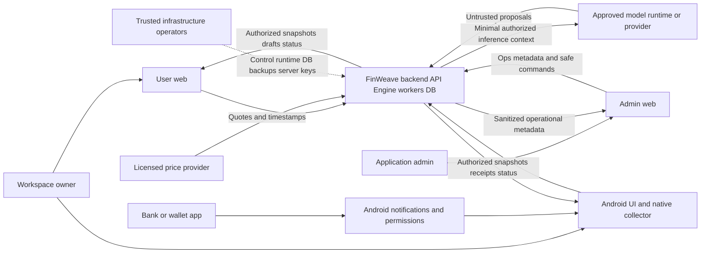

> **ARCH-12 hiện hành — 09/10/2026:** [Agent LLD](../agent/README.md) và [ADR019](../architecture/adr/ADR-019-bounded-agent-runtime-and-grounded-planning.md). Current **[API005](../contracts/v2-t1-r5/README.md) / DB005 / native bridge003**, [bundle/hash](../agent/implementation-bundle.json); Assistant mode/counter output delta, request/roles unchanged. **Design SPECIFIED; model disabled; runtime/evals NOT RUN.** Kế thừa AI-SPEC và các gói ARCH06–11 bằng explicit binding, không sửa historical packages/frontend.

> **ARCH-11 hiện hành — 09/10/2026:** [Sources](../sources/README.md), [ADR018](../architecture/adr/ADR-018-verified-source-profiles-and-market-entitlements.md) và [bundle pin](../sources/implementation-bundle.json). Chốt source profile/normalization/rights/consumer mapping; API004/DB005/bridge2 giữ nguyên. **Design SPECIFIED; REAL SOURCES NOT ACTIVATED; runtime NOT RUN.** ARCH11 làm rõ nguồn/binding/Review; notes ARCH05…10 là base và lịch sử, không evidence live support.

> **ARCH-10 hiện hành — 09/10/2026:** [Android design](../android/README.md), [ADR017](../architecture/adr/ADR-017-android-native-collector-and-signed-apk.md) và [bundle pin](../android/implementation-bundle.json). Capacitor/Kotlin, native identity/Room/Keystore/WorkManager, bridge2, support/clock/retention và signed APK. API004/DB005 giữ nguyên; frontend không sửa. **Design SPECIFIED; APK NOT BUILT, Android/runtime NOT RUN.** ARCH10 thay mô tả native cũ khi khác; notes ARCH05…09 là lịch sử và vẫn là base security/domain/async.

> **ARCH-09 hiện hành — 09/10/2026:** [Async/sync](../async/README.md), [API004: 153 operations / 634 schemas](../contracts/v2-t1-r4/README.md), [DB005: 87 bảng / 1001 cột](../data/target-t1-async/README.md) và [bundle/hashes](../async/implementation-bundle.json). Kế thừa đầy đủ tính năng; sửa CSV selectors và coverage paging, chốt J2/retry/ACK/scheduler/quota/cancellation/offline. **Thiết kế đã chốt; backend/SQL/native/provider/concurrency NOT RUN.** Các notes ARCH-05…08 bên dưới là lịch sử revision; target hiện hành theo004/005 và addenda này.

# FinWeave — Context Model v3.0

REQ-CTX-001 · 08/10/2026 · **ARCH-01 ACCEPTED: A + T1**. Context nghiệp vụ/toàn bộ phạm vi, không là đặc tả endpoint. [HLD](../architecture/high-level-design.md), [views](../architecture/views/architecture-views.md), [ADR-008](../architecture/adr/ADR-008-modular-backend-trusted-server.md), [SRS](srs.md).

## 1. Actors và ranh giới

FinWeave gồm User Web, Android APK với UI/native collector, Admin Web và modular backend/API/Engine/workers/PostgreSQL. Owner thao tác finance qua web/mobile; app-admin vận hành qua Ops metadata API. Người quản trị host/runtime/DB/backup là trusted infrastructure operator theo T1, khác role admin ứng dụng. AI Agent sản phẩm khác agent phát triển phần mềm.

Android OS và app ngân hàng/ví là nguồn notification bên ngoài; không hàm ý bank API hoặc quyền chuyển tiền. Price provider cung cấp quote có quyền sử dụng. Model runtime/provider chỉ nhận context theo privacy/egress decision riêng; output là untrusted proposal, không authority tài chính.

## 2. Context diagram

Finance dạng rõ được xử lý trong trusted server boundary, network dùng authenticated TLS. Infra arrow mô tả khả năng kỹ thuật, không cấp admin API đọc finance. External LLM không tự thuộc trust boundary; diagram chưa xác nhận deployment hoặc egress đã chạy.

## 3. Interfaces nghiệp vụ

Giữ IF-01…09 để kế thừa traceability, thay mô tả fixture-only bằng đích sản phẩm; fixture vẫn dùng kiểm local synthetic.

| Interface | Bên ngoài ↔ FinWeave | Dữ liệu / hành vi và giới hạn |
| --- | --- | --- |
| IF-01 | Owner ↔ accounts/holdings setup | Opening/date/currency, stock ticker+quantity, gold profile+chỉ → validation/labels; không income/giao dịch mua giả |
| IF-02 | Owner ↔ actual ledger | Thu/chi/transfer/refund/fee/count/correction/quantity/category → preview/confirm/history; server rules/version |
| IF-03 | Owner CSV / Android normalized records → ingestion | CSV mapping/preview/confirm hoặc minimum evidence → durable receipt/status/posting/Review; ACK không là posted |
| IF-04 | Licensed provider ↔ Market workers | Instrument/gold product/side/unit/time/currency → quotes/last-good/freshness; daily/manual, không thay cash/quantity |
| IF-05 | Owner ↔ snapshots/drill-down/Review | Kỳ/scope/filter/evidence/decision → consistent versions/provenance/coverage; missing không zero |
| IF-06 | Owner ↔ local demo/privacy | Synthetic reset/scenarios và display masking; production không reset ledger bằng demo; mask không là encryption |
| IF-07 | Owner ↔ Home reports/Insights | Snapshot/insight refs theo kỳ; không Reports riêng, /home/reports redirect về Home |
| IF-08 | Owner ↔ Plan/Goals/Simulation | Manual/Agent draft, allocations/scenarios/compare/preview/confirm → Plan/Goal/history; actual chỉ đọc/link |
| IF-09 | Owner ↔ Assistant/Agent | Chat/panel/mascot cùng context/history; clarify/investigate/replan, Engine/tools/drafts; không tự confirm/actual write |
| IF-10 | Owner/device ↔ Identity/Devices | Auth/session/enroll/consent/binding/revoke/switch, outbox/sync health; không cross-owner upload |
| IF-11 | App-admin ↔ Ops API | Sources/jobs/parser/quota/releases/incidents/audit, safe retry/disable; không finance/raw/prompt/impersonation |
| IF-12 | Backend ↔ approved model runtime/provider | Minimal authorized context/tool results và proposals, budget/cancel/validation; secrets server-only |
| IF-13 | Trusted infrastructure ↔ runtime/storage/backup | Deploy/configure/migrate/rotate/restore/monitor với least privilege/audit; có khả năng kỹ thuật đọc finance theo T1 |

IF-FUT-01/02 của context cũ là protected interfaces còn chờ thiết kế, được thay cho đích T1 bằng IF-10…13 và user/device/provider interfaces nêu trên. Không bỏ chức năng hoặc thêm financial mutation cho admin/Agent.

## 4. Ba luồng và state chuẩn

| Luồng | Input → canonical state → clients |
| --- | --- |
| Notification | Consent/OS/allowlist → native filter/normalize → encrypted durable outbox → API receipt ACK → worker parse/match/dedupe → posting hoặc Review → web/mobile snapshot |
| Giá | Daily/manual → durable coalesced job/quota → licensed quote → Engine valuation → clients fetch; client tắt không tắt scheduler, host phải hoạt động |
| Plan–Goals/Agent | Intent → facts/clarification → Engine alternatives → linked draft → owner preview/confirm → atomic Plan/Goal/links/history/replay; actual ledger không đổi |

Mỗi workspace có canonical ledger; evidence/quotes/planning state có provenance/versions riêng. Read models/cache dẫn xuất. Notifications có thể thiếu: biểu diễn gaps/coverage, không tự tuyên bố sao kê đầy đủ. Offline clients có thể tạm khác version, hội tụ khi refresh đúng quyền; response cũ không đè version mới.

## 5. Truy vết và hiện trạng

[50 mục UI](../design/interface-catalogue.md), [41 AC](../execution/realignment-traceability.md), [133 operations](../product/backend-operation-backlog.csv), [86 actions](../product/backend-action-coverage.csv), [21 gói REQUIRED](../product/backend-backlog.md) là inventories đối chiếu, không khẳng định đã implement/test.

Frontend [r2](../governance/baselines/FW-HANDOVER-20261008-r2/README.md) nghiệm thu synthetic checked-scope; backend/SQL/auth/security/APK/native/providers/model/UAT chưa nghiệm thu. T1 không bật real frontend transport hoặc cấp budget/deploy/provider calls. Snapshot context cũ trong r1/r2 giữ nguyên.

## ARCH-09 — Notification/price/Plan–Goals async context

Android listener/outbox→device API durable receipt→IngestionWorker→sealed Ledger hoặc Review; owner web/mobile đọc typed status/projection. Host scheduler→MarketWorker→approved provider→fenced observations; shared quota trước network. Assistant/Agent và ForecastWorker chỉ read/simulate/draft/results, owner confirm Plan/Goals riêng, không actual. Ops safe-control mapping không finance access.

[Hồ sơ async](../async/README.md), [API004](../contracts/v2-t1-r4/README.md), [DB005](../data/target-t1-async/README.md), [ADR-016](../architecture/adr/ADR-016-postgresql-dispatch-and-explicit-sync-outcomes.md), [32 ca runtime](../async/acceptance-plan.md).

## ARCH-10 — Android implementation handover

Notification special access independent own-push permission; browser cannot read apps. User can decline collector and use all other features. External browser has no native FinWeave bridge.

[Chi tiết Android](../android/README.md) · [Acceptance32 NOT RUN](../android/acceptance-plan.md) · [Báo cáo ARCH10](../architecture/ARCH-10-change-report.md).

## ARCH-11 — Source integration handover

Bank/wallet app external notifications là observed evidence, không full statement/cryptographic bank verification. Market provider là external licensed read-only source; owner/source selection/consent/rights là gates riêng.

[Source design](../sources/README.md) · [Acceptance32 NOT RUN](../sources/acceptance-plan.md) · [Báo cáo ARCH11](../architecture/ARCH-11-change-report.md).

## ARCH-12 — Agent runtime handover

Model/inference là untrusted decision generator dưới trusted T1 host; server ToolGateway/Engine quyết authority. Source-derived context cần use-specific rights kể cả local non-display, cloud thêm external egress grant.

[Runtime design](../agent/README.md) · [Acceptance32 NOT RUN](../agent/acceptance-plan.md) · [Báo cáo ARCH12](../architecture/ARCH-12-change-report.md).
